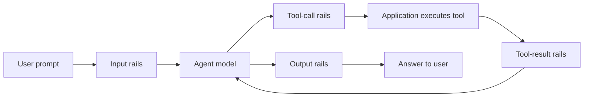

# NVIDIA NeMo Guardrails Library

Programmable guardrails for AI agents and the tools they use.

[](https://opensource.org/licenses/Apache-2.0)
[](https://pypi.org/project/nemoguardrails)
[](https://pypi.org/project/nemoguardrails)
[](https://github.com/NVIDIA-NeMo/Guardrails/actions/workflows/pr-tests.yml)
[](https://docs.nvidia.com/nemo/guardrails)

[Documentation](https://docs.nvidia.com/nemo/guardrails/latest/about-nemo-guardrails-library/overview) · [Quickstart](#check-a-tool-call) · [Use cases](#what-you-can-build) · [Comparison](#how-nemo-guardrails-is-different) · [Guardrail catalog](#guardrail-catalog) · [Examples](./examples)

**NeMo Guardrails adds programmable safeguards to AI agents.** For agents that run commands, call APIs, query data, or access the web, define policies to validate inputs, outputs, tool calls, and tool results. Apply deterministic rules or model-based checks to detect jailbreak attempts, prompt injection, and unsafe tool use. Your application or agent harness invokes the checks at configured points in the workflow and enforces their results before continuing execution.

To get started:

```bash
pip install nemoguardrails
```

> [!NOTE]
> This README describes the development branch. The agent quickstart uses a source installation from `develop`. For a released package, refer to the documentation for your installed version. IORails and the proxy described below are experimental.

## How It Works

Your agent calls Guardrails at the boundaries you want to check. For example, a tool-using agent can apply checks at four points:



Guardrails returns a verdict, and your application or agent harness enforces it.
Execute a tool only after its call passes, and send a tool result to the model only after its checks pass.
The library does not execute tools for you.

## Why NeMo Guardrails

The library provides the following capabilities:

- **Govern what agents do.** The IORails engine checks calls against declared tools and their argument schemas before execution. It can also validate tool results and apply additional checks per tool before the model receives them.
- **Keep your model and agent loop.** Use `check_async()` or the HTTP `/v1/checks` endpoint to run checks without invoking a main model. Model-backed rails still call their configured guard model or service.
- **Choose checks for the task.** Tool validation, regex, and Common Expression Language (CEL) rules run locally without a model call. For supported configurations, IORails can also run rails in parallel or overlap input checks with generation using speculative mode. Speculative generation sends input to the model before the input checks finish, even if they later block it.
- **Distinguish blocks from failures.** IORails tool checks fail closed and report policy violations separately from rail execution failures. Your application or hook configuration determines how to handle a failed check.
- **Compose the policy you need.** Combine deterministic checks with content safety, topic control, jailbreak detection, sensitive data masking, and other rails. Checks run where you configure and invoke them.
- **Open and yours to run.** The library is Apache 2.0 licensed. Deploy it in your own application or run a guardrails service, choosing local detectors or hosted endpoints for each check.

## Installation

The library supports Python 3.10–3.13. Optional integrations have their own extras, packages, and credentials. Refer to the [installation guide](https://docs.nvidia.com/nemo/guardrails/latest/get-started/installation-guide) for details.

## Check a Tool Call

Suppose a support agent can issue refunds, but each refund must be at most $500.
This example validates the tool's arguments and applies that limit locally.
It needs no model or API key.

Use Python 3.11–3.13 for the optional `cel` extra. In an activated virtual environment, install the development version:

```bash
git clone --branch develop https://github.com/NVIDIA-NeMo/Guardrails.git
cd Guardrails
pip install -e ".[cel]"
```

Create `support-agent/config.yml`:

```yaml
models: []

rails:
  tool_call:
    flows:
      - tool call validation
    per_tool:
      issue_refund:
        - cel check tool call
  config:
    cel:
      tool_call:
        issue_refund:
          expressions:
            - "args.amount > 500"
```

A CEL expression that evaluates to `true` blocks the call. Save the following as `check_refund.py` beside the `support-agent` directory:

```python
import asyncio
import json

from nemoguardrails import Guardrails, RailsConfig
from nemoguardrails.rails.llm.options import RailStatus, RailType

TOOLS = [{
    "type": "function",
    "function": {
        "name": "issue_refund",
        "parameters": {
            "type": "object",
            "properties": {"amount": {"type": "number", "minimum": 0}},
            "required": ["amount"],
            "additionalProperties": False,
        },
    },
}]


async def main():
    config = RailsConfig.from_path("./support-agent")
    async with Guardrails(config, require_iorails=True) as rails:
        for amount in (50, 5000):
            call = {
                "role": "assistant",
                "content": None,
                "tool_calls": [{
                    "id": "call_1",
                    "type": "function",
                    "function": {
                        "name": "issue_refund",
                        "arguments": json.dumps({"amount": amount}),
                    },
                }],
            }
            result = await rails.check_async(
                [call], rail_types=[RailType.TOOL_CALL], tools=TOOLS
            )
            print(f"${amount}: {result.status.value}")
            if result.status == RailStatus.PASSED:
                print("Ready for the application to execute")


asyncio.run(main())
```

Run it from the repository root:

```bash
python check_refund.py
```

Expected output:

```text
$50: passed
Ready for the application to execute
$5000: blocked
```

The script checks proposed calls without issuing a refund.
In your agent loop, execute a tool only when the check passes.
`require_iorails=True` makes an incompatible configuration raise an error instead of falling back to the legacy engine.

To extend the example, configure `rails.tool_result` and check returned tool messages with `RailType.TOOL_RESULT`.
For complete configuration and result handling, refer to [tool calling](https://docs.nvidia.com/nemo/guardrails/latest/configure-guardrails/guardrail-catalog/tool-calling), [CEL rules](./docs/configure-rails/guardrail-catalog/cel.mdx), and [checking messages](https://docs.nvidia.com/nemo/guardrails/latest/run-guardrailed-inference/using-python-apis/check-messages).
You can also add [content safety](./docs/configure-rails/guardrail-catalog/content-safety.mdx) and [topic control](./docs/configure-rails/guardrail-catalog/topic-control.mdx) rails to check incoming prompts. Model-backed checks require a configured model and any credentials required by its provider.

## What You Can Build

### A Shared Guardrails Service

Run `nemoguardrails server` and send checks to `/v1/checks` while your applications call their models and execute their tools.
The server can load multiple configurations, selected by `config_id`.
To check tool calls and results, enable IORails for compatible configurations and send tool data in the OpenAI Chat Completions shape.
Refer to [checking messages with the server](https://docs.nvidia.com/nemo/guardrails/latest/run-guardrailed-inference/using-python-apis/check-messages#guardrails-server).

Alternatively, use `generate_async()` or `/v1/chat/completions` to send generation requests through Guardrails to a configured model.
Built-in IORails tool validation for generation supports the `openai` and `nim` engines.
Refer to [Python APIs](https://docs.nvidia.com/nemo/guardrails/latest/run-guardrailed-inference/using-python-apis) and the [Guardrails API server](https://docs.nvidia.com/nemo/guardrails/latest/run-guardrailed-inference/using-fastapi-server).

### An Inference Gateway

The [experimental proxy](./docs/run-rails/using-proxy/index.mdx) adds checks at the HTTP boundary between clients and model services.
Its current built-in profiles inspect supported text requests and responses.
They do not cover tool traffic, conversation histories, or multimodal content.
Review the [provider and streaming coverage](./docs/run-rails/using-proxy/providers-and-streaming.mdx) before connecting an application.

### Coding Agents and Harnesses

Use `nemoguardrails hooks-server` with Claude Code or Codex to check `PreToolUse` calls before the agent runs them.
A NeMo Relay plugin can also forward its tool conditional-execution checks to `/v1/hooks/nemo-relay`.
The hooks server checks tool calls only. It does not check prompts, tool results, or final answers.

Start with the [hooks examples](./examples/configs/agent_hooks) and [hooks server guide](./docs/run-rails/using-hooks-server/index.mdx). Configure the agent's failure behavior to block tool execution when a hook check cannot complete, and combine hooks with the agent's own permissions and sandboxing.

### An Agent Platform or Framework

Embed `Guardrails.check_async()` in a custom agent loop to check prompts, tool calls, tool results, and answers at the boundaries your application invokes. Tool checks require IORails and Chat Completions tool and message shapes.

For LangChain agents, [GuardrailsMiddleware](./docs/integration/langchain/agent-middleware.mdx) applies configured input and output rails around model calls.
Those text rails do not inspect tool-call arguments or tool-result content.
LangChain's `RunnableRails` can wrap chains and runnables.
Both integrations require LangChain packages.
`RunnableRails` also requires the opt-in `NEMOGUARDRAILS_LLM_FRAMEWORK=langchain` setting or `set_default_framework("langchain")`.
Refer to [LangChain integration](https://docs.nvidia.com/nemo/guardrails/latest/integration-with-third-party-libraries/langchain/langchain-integration).

The Guardrails API server, hooks server, and experimental proxy are separate applications with different configuration requirements. Server installations require the `server` extra.

## How NeMo Guardrails Is Different

NeMo Guardrails combines tool validation, per-tool policies, and content checks in a configurable layer that runs in your application or as a service.
The following table uses named examples of other approaches to compare where checks run, how you configure them, and how you deploy them:

| Capability | NeMo Guardrails | Cloud-Managed Guardrails: [Amazon Bedrock](https://docs.aws.amazon.com/bedrock/latest/userguide/guardrails-use-invoke-guardrail-checks.html) | Agent SDK Guardrails: [OpenAI Agents SDK](https://openai.github.io/openai-agents-python/guardrails/#tool-guardrails) | Guarded Proxy: [LiteLLM](https://docs.litellm.ai/docs/proxy/guardrails/quick_start) | Validator Library: [Guardrails AI](https://guardrailsai.com/guardrails/docs/concepts/validators) |
| --- | --- | --- | --- | --- | --- |
| Gate a tool call before execution | Configured IORails tool-call rails validate tools and schemas; the application enforces the verdict | Call the checks API before dispatch; the application acts on returned detection scores | Tool-input guardrails run inside the SDK's function-tool execution pipeline | [Tool policies](https://docs.litellm.ai/docs/proxy/tool_policies) check tool traffic that passes through the model or MCP gateway | Invoke validation before dispatch and enforce the configured failure policy |
| Check tool results for indirect prompt injection | Configure per-tool rules or a model judge to check results before model use | Submit result content to prompt-attack checks and apply a threshold in the application | Attach a detector to tool-output guardrails for supported function tools | Configure a detector or [custom guardrail](https://docs.litellm.ai/docs/proxy/guardrails/custom_guardrail) on content passing through the proxy | Apply a suitable validator to returned content before forwarding it to the model |
| Apply deterministic rules | Local tool-schema, regex, and CEL checks | [Word-list and regex policies](https://docs.aws.amazon.com/AWSCloudFormation/latest/TemplateReference/aws-resource-bedrock-guardrail.html) evaluated by the managed service | Python validation functions attached to agents or tools | Custom guardrail code runs in the proxy | Custom Python validator functions |
| Connect coding agents | Claude Code and Codex pre-tool hooks; NeMo Relay plugin endpoint | Custom integration calls the service API from the harness | Guardrails execute within the SDK runner | Route supported model or MCP traffic through the gateway; local execution needs its own integration | Custom integration invokes validators from the harness |
| Reuse checks across models and frameworks | Python and HTTP interfaces, subject to engine and integration support | [Model-independent API](https://docs.aws.amazon.com/bedrock/latest/userguide/guardrails-use-independent-api.html) callable from application code | Reuse guardrail callbacks within SDK workflows | Route supported providers through a shared gateway | Invoke the validation library from application code |
| Define policy separately from agent logic | YAML and Colang configuration files | Guardrail resources, including CloudFormation configuration, or per-request safeguards | Python guardrail functions attached to agent and tool definitions | YAML guardrail configuration and custom guardrail classes | Python configuration or RAIL specifications |
| Choose the deployment environment | Embed the library or run a self-hosted service | AWS-hosted checks | SDK runs in the application; model and tracing connections are configured separately | Self-hosted gateway with local or service-backed detectors | Library runs in the application; selected validators determine dependencies |
| Choose guard models | Configure compatible open-weight or hosted models for model-backed rails | [AWS manages the underlying guard models](https://docs.aws.amazon.com/bedrock/latest/userguide/guardrails-how.html) | Call a classifier or model from a guardrail callback | Choose a detector integration or implement a custom guardrail | Choose or implement a model-backed validator |

These examples describe the named implementations, not every product in each category. Tool coverage depends on the integration path, and a hook or validator needs a configured detector to check for prompt injection. Offline operation depends on the selected models, detectors, and telemetry or tracing configuration.

Evaluate any of these approaches against representative attacks and legitimate requests. External scanners such as [garak](https://github.com/NVIDIA/garak) can test supported targets across approaches. Refer to the [vulnerability-scanning guide](./docs/evaluation/llm-vulnerability-scanning.mdx) for a NeMo Guardrails example.

## Guardrail Catalog

The following table lists example checks at each checkpoint:

| Checkpoint | Rail Type | Example Checks |
| --- | --- | --- |
| Prompt in | `input` | Content safety, topic control, jailbreak and prompt-injection detection, sensitive data detection and masking |
| Tool call out | `tool_call` | Declared-tool allowlist, JSON Schema validation, per-tool regex, CEL rules, and model-backed tool safety checks |
| Tool result in | `tool_result` | Linkage to a prior call, result shape and name validation, per-tool regex, CEL rules, and model-backed tool safety checks |
| Answer out | `output` | Content safety, fact-checking, hallucination detection, sensitive data detection and masking |
| Retrieval | `retrieval` | Filter or mask retrieved content before it enters a model's context |

The library also supports Colang dialog flows and custom action execution rails for applications that need them.
Rail support varies by engine. Refer to [rail engine support](https://docs.nvidia.com/nemo/guardrails/latest/reference/rail-engine-support) when choosing or combining checks.

The [guardrail catalog](https://docs.nvidia.com/nemo/guardrails/latest/configure-guardrails/guardrail-catalog) covers NVIDIA safety models, community models, and third-party integrations. These include ActiveFence, AutoAlign, Cisco AI Defense, Clavata, Cleanlab, CrowdStrike AIDR, F5, Fiddler, GCP Text Moderation, GLiNER, Guardrails AI, Pangea, Patronus Lynx, PolicyAI, Polygraf, Private AI, Prompt Security, and Trend Micro. Each integration has its own setup requirements. The [examples](./examples) show configurations for individual rails and integrations.

> [!IMPORTANT]
> Built-in guardrails might not suit every production use case. Work with your application and security teams to verify that your guardrails meet your requirements.

Evaluate your policy against representative allowed and blocked requests before deployment.
For testing and deployment guidance, refer to the [evaluation guide](https://docs.nvidia.com/nemo/guardrails/latest/evaluation) and [security guidelines](https://docs.nvidia.com/nemo/guardrails/latest/resources/guidelines).

## Telemetry and Privacy

The library sends anonymous usage events at startup and periodic heartbeats. Event payloads describe the library version, platform, configured engine providers, active rail categories and built-in features, and deployment mode. They exclude prompts, completions, model names, credentials, and endpoints. Per-request tracing is configured separately.

To opt out, set either environment variable before starting the library:

```bash
export NEMO_GUARDRAILS_NO_USAGE_STATS=1
# Or: export DO_NOT_TRACK=1
```

Refer to [telemetry and privacy](https://docs.nvidia.com/nemo/guardrails/latest/resources/telemetry) for the full schema, local audit file, opt-out options, and third-party endpoint terms.

## Contributing and Support

Refer to [CONTRIBUTING.md](./CONTRIBUTING.md) for setup, issue assignment, validation, and pull request requirements, and [AI_POLICY.md](./AI_POLICY.md) for AI-assisted contributions. Ask usage questions in [GitHub Discussions](https://github.com/NVIDIA-NeMo/Guardrails/discussions).

## License and Citation

The library is licensed under the [Apache License, Version 2.0](./LICENSE-Apache-2.0.txt).

If you use the NVIDIA NeMo Guardrails library in research, cite the [EMNLP 2023 paper](https://aclanthology.org/2023.emnlp-demo.40):

```bibtex
@inproceedings{rebedea-etal-2023-nemo,
    title = "{N}e{M}o Guardrails: A Toolkit for Controllable and Safe {LLM} Applications with Programmable Rails",
    author = "Rebedea, Traian  and
      Dinu, Razvan  and
      Sreedhar, Makesh Narsimhan  and
      Parisien, Christopher  and
      Cohen, Jonathan",
    editor = "Feng, Yansong  and
      Lefever, Els",
    booktitle = "Proceedings of the 2023 Conference on Empirical Methods in Natural Language Processing: System Demonstrations",
    month = dec,
    year = "2023",
    address = "Singapore",
    publisher = "Association for Computational Linguistics",
    url = "https://aclanthology.org/2023.emnlp-demo.40",
    doi = "10.18653/v1/2023.emnlp-demo.40",
    pages = "431--445",
}
```
