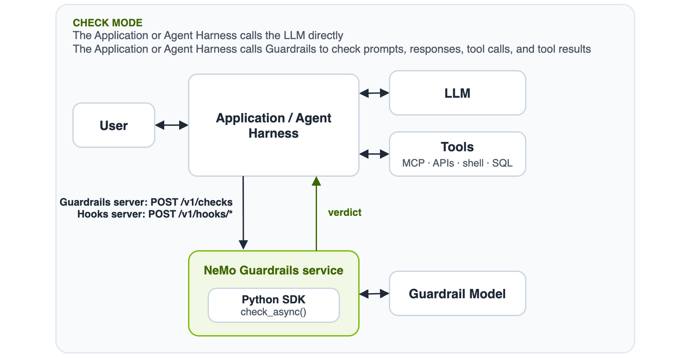
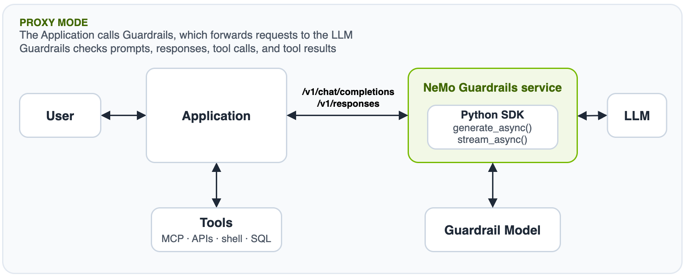
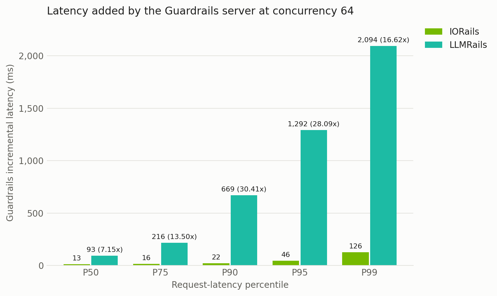
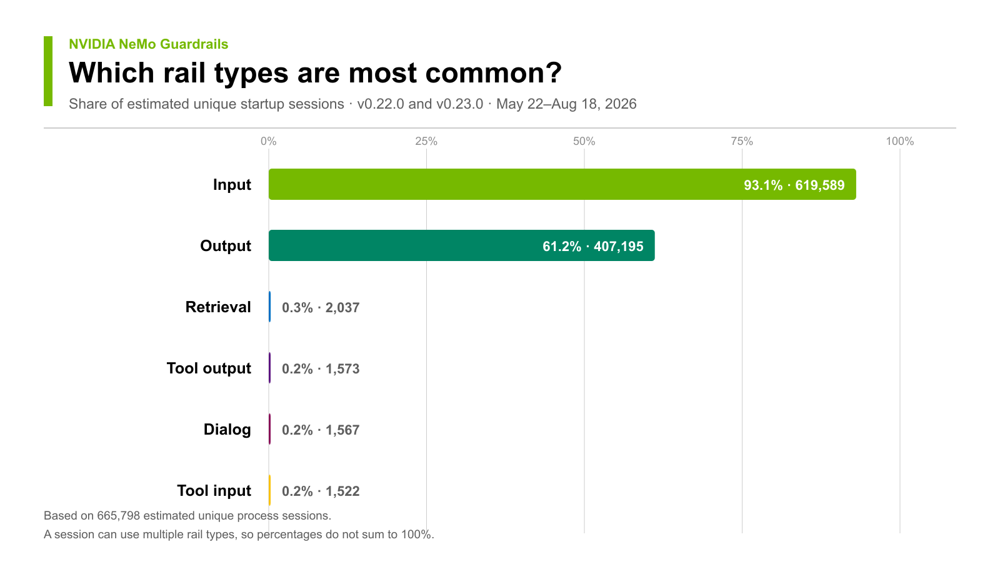
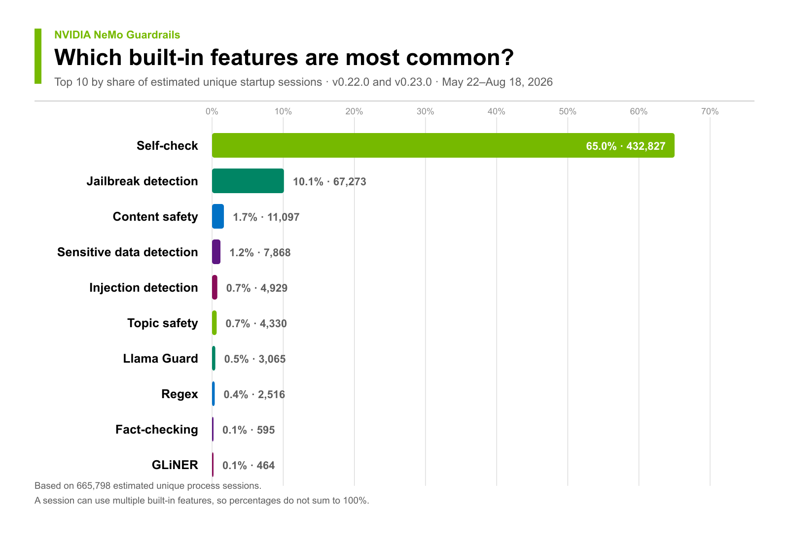
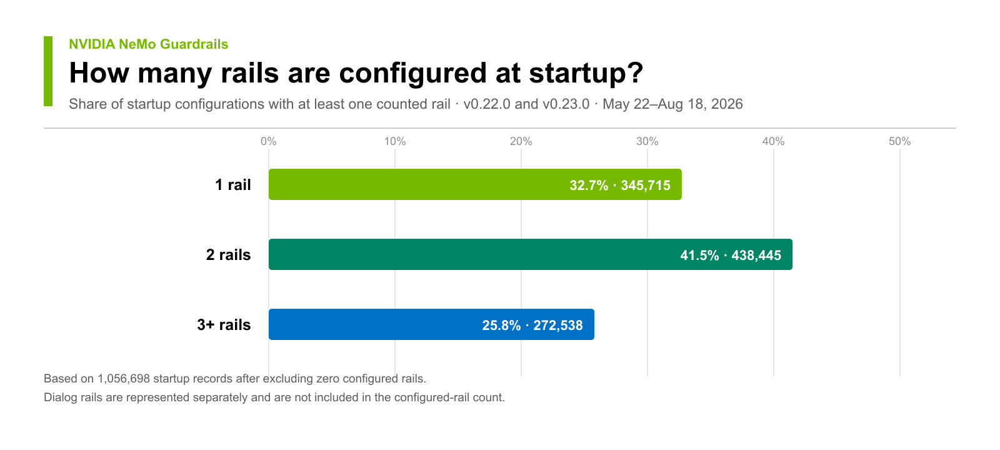

# NVIDIA NeMo Guardrails Library

[](https://opensource.org/licenses/Apache-2.0)
[](https://pypi.org/project/nemoguardrails)
[](https://pypi.org/project/nemoguardrails)
[](https://github.com/NVIDIA-NeMo/Guardrails/actions/workflows/pr-tests.yml)
[](https://github.com/NVIDIA-NeMo/Guardrails/actions/workflows/full-tests.yml)
[](https://github.com/NVIDIA-NeMo/Guardrails/actions/workflows/full-tests.yml)
[](https://github.com/NVIDIA-NeMo/Guardrails/actions/workflows/lint.yml)
[](https://docs.nvidia.com/nemo/guardrails)
[](https://pepy.tech/project/nemoguardrails)
[](https://pepy.tech/project/nemoguardrails)

[Documentation](https://docs.nvidia.com/nemo/guardrails/latest/about-nemo-guardrails-library/overview) · [Quickstart](#quickstart) · [Use cases](#what-you-can-build) · [Integrations](#choose-your-integration) · [Guardrail catalog](#guardrail-catalog) · [Examples](./examples) · [Community](#community-usage) · [Security](./SECURITY.md) · [Releases](https://github.com/NVIDIA-NeMo/Guardrails/releases) · [Changelog](./CHANGELOG.md)

NeMo Guardrails is an open-source library for applying programmable safety and security controls to LLM and agentic applications. Agents run commands, call APIs, query your data, and read the web. Conversational applications apply input and output checks; retrieval-augmented generation (RAG) systems filter retrieved content and check answers against evidence.

You use the NeMo Guardrails library to declare what each agent may do in a policy, combining low-latency local rules with model-backed checks for jailbreaks, injected instructions, and unsafe tool calls. Your application or agent harness runs these checks and uses their results to decide whether to continue.

```bash
pip install nemoguardrails
```

Requires Python 3.11–3.13. Refer to the [installation guide](https://docs.nvidia.com/nemo/guardrails/latest/get-started/installation-guide) for optional packages and setup.

> [!NOTE]
> Version 0.25.0 deprecates `LLMRails`, with removal planned no earlier than 0.27.0. Use `Guardrails` for new integrations and follow the [migration guide](./docs/migration/0.25.mdx).

## What You Can Build

- **AI agents and coding assistants:** Check proposed tool calls and returned results with [tool rails](./docs/configure-rails/guardrail-catalog/tool-calling.mdx), or connect an agent through the [hooks server](./docs/run-rails/using-hooks-server/index.mdx).
- **Conversational applications:** Apply [input and output checks](./docs/run-rails/using-python-apis/check-messages.mdx).
- **Retrieval-augmented generation (RAG):** [Detect or mask sensitive data in retrieved content](./docs/configure-rails/guardrail-catalog/pii-detection.mdx) and [check whether answers are grounded in evidence](./docs/configure-rails/guardrail-catalog/fact-checking.mdx).

## How It Works

Use the NVIDIA NeMo Guardrails library to define your policy in configuration files that specify the rails, models, and prompts to use.
Run the library in your Python application or deploy it as a server.
Choose check mode or proxy mode based on how your application manages model requests.

### Check Mode

Your application or agent harness calls the LLM and executes tools directly.
At each point that requires a policy decision, send the relevant prompt, model response, tool call, or tool result to the library for checking.
Use the result to handle blocked or modified content before you execute a tool, return a response, or pass a tool result to the model.

Use [`check_async()`](./docs/run-rails/using-python-apis/check-messages.mdx) in Python, `POST /v1/checks` on the Guardrails server, or the [hooks server](./docs/run-rails/using-hooks-server/index.mdx) for coding agents.
For tool checks with `check_async()`, use the IORails engine and specify `RailType.TOOL_CALL` or `RailType.TOOL_RESULT` in `rail_types`.
Check tool calls before execution and tool results after execution.



### Proxy Mode

Route model requests through the library to apply the configured input and output rails.
Input rails can block a request before it reaches the application LLM.
For non-streaming requests, output rails check the response before the library returns it.
Blocked content produces a refusal or an error, depending on the integration and configuration.

Use `generate_async()` or `stream_async()` in Python, or `POST /v1/chat/completions` on the Guardrails server.
Your application executes tools; supported integrations can check tool calls in model responses and tool results in subsequent requests.
The [gateway server](./docs/run-rails/using-proxy/providers-and-streaming.mdx) also supports `POST /v1/chat/completions` and `POST /v1/responses`, but its built-in profiles do not support tool content.
Each gateway `/v1/responses` request must include `"store": false`.

When output streaming is enabled for `stream_async()`, the default `stream_first: true` setting delivers chunks before checking them.
To check each chunk before delivery, set `rails.output.streaming.stream_first: false`.
For configuration details, refer to [output rail streaming](./docs/configure-rails/yaml-schema/streaming/output-rail-streaming.mdx).



Latency depends on the configured rules, models, and services.
Rail support varies by engine and integration.
Refer to [rail engine support](./docs/reference/rail-engine-support.mdx), [configuration](./docs/configure-rails/configuration-reference.mdx), and [Choose Your Integration](#choose-your-integration).

## Why NeMo Guardrails

- **Govern what agents do.** Validate tool names and argument schemas before execution. Check tool results and apply per-tool policies before returning them to the model.
- **Keep your model and agent loop.** Use [checks without main-model generation](./docs/run-rails/using-python-apis/check-messages.mdx) to add guardrails to an existing application. Model-backed checks still call their configured model or service.
- **Compose the policy you need.** Combine local [regex](./docs/configure-rails/guardrail-catalog/community/regex.mdx) and [CEL](./docs/configure-rails/guardrail-catalog/cel.mdx) rules with safety models and third-party checks.
- **Connect your runtime.** Choose an [integration](#choose-your-integration) for your application, shared service, or coding agent.
- **Open and yours to run.** The library is Apache 2.0 licensed. Choose [supported model providers](./docs/about/supported-llms.mdx) and run checks with local detectors or hosted inference endpoints.

## Quickstart

Check a support agent's proposed refund against a $500 limit, without a model or API key.
Install the optional CEL extra for this example:

```bash
pip install "nemoguardrails[cel]"
```

The example validates the tool's argument schema and blocks calls over the limit. Expand it and save it as `check_refund.py`:

<details>
<summary>Complete Python example</summary>

```python
import asyncio
import json

from nemoguardrails import Guardrails, RailsConfig
from nemoguardrails.rails.llm.options import RailStatus, RailType

config = RailsConfig.from_content(yaml_content="""
models: []
rails:
  tool_call:
    flows: [tool call validation]
    per_tool:
      issue_refund: [cel check tool call]
  config:
    cel:
      tool_call:
        issue_refund:
          expressions: ["args.amount > 500"]
""")

TOOLS = [{
    "type": "function",
    "function": {
        "name": "issue_refund",
        "parameters": {
            "type": "object",
            "properties": {"amount": {"type": "number", "minimum": 0}},
            "required": ["amount"],
            "additionalProperties": False,
        },
    },
}]


async def main():
    async with Guardrails(config, require_iorails=True) as rails:
        for amount in (50, 5000):
            call = {
                "role": "assistant",
                "tool_calls": [{
                    "id": "call_1",
                    "type": "function",
                    "function": {
                        "name": "issue_refund",
                        "arguments": json.dumps({"amount": amount}),
                    },
                }],
            }
            result = await rails.check_async(
                [call], rail_types=[RailType.TOOL_CALL], tools=TOOLS
            )
            print(f"${amount}: {result.status.value}")
            if result.status == RailStatus.PASSED:
                print("Ready for the application to execute")
            else:
                print(f"Rail: {result.rail}")
                print(f"Reason: {result.reason}")


asyncio.run(main())
```

</details>

Run it from the directory where you saved the file:

```bash
python check_refund.py
```

Expected output:

```text
$50: passed
Ready for the application to execute
$5000: blocked
Rail: cel check tool call
Reason: cel check tool call
```

The example does not issue refunds. Your application executes a tool only after its checks pass.
For more configuration and error-handling examples, refer to [tool calling](./docs/configure-rails/guardrail-catalog/tool-calling.mdx) and [checking messages](./docs/run-rails/using-python-apis/check-messages.mdx).

## Choose Your Integration

Connect NeMo Guardrails where your application or agent can enforce its checks.

| What are you building? | How to connect |
| --- | --- |
| **A shared guardrails service** for multiple applications or teams | Use the [Checks API](./docs/run-rails/using-fastapi-server/overview.mdx) (`/v1/checks`) to request verdicts while each application manages its model and execution loop. |
| **A guardrails layer** for existing model APIs | Use the [gateway server](./docs/run-rails/using-gateway/quickstart.mdx) to check supported requests and responses while preserving provider formats. |
| **A coding assistant or agent harness** | Use [native hooks](./docs/run-rails/using-hooks-server/run-hooks-server.mdx) or [NeMo Relay](./docs/run-rails/using-hooks-server/nemo-relay-plugin.mdx) to check tool calls before execution. |
| **An agent platform, framework integration, or custom loop** | Embed the [Python SDK](./docs/run-rails/using-python-apis/check-messages.mdx), call the [Checks API](./docs/run-rails/using-fastapi-server/overview.mdx), or use a supported [framework integration](./docs/integration/langchain/langgraph-integration.mdx). |

## Guardrail Catalog

Choose checks for your policy and workflow:

| Check | Purpose |
| --- | --- |
| [Content safety](./docs/configure-rails/guardrail-catalog/content-safety.mdx) | Check inputs and outputs against safety policies. |
| [Topic control](./docs/configure-rails/guardrail-catalog/topic-control.mdx) | Check inputs against configured topical guidelines. |
| [Jailbreak detection](./docs/configure-rails/guardrail-catalog/jailbreak-protection.mdx) | Detect jailbreak attempts with configured heuristics or classifiers. |
| [Injection detection](./docs/configure-rails/guardrail-catalog/agentic-security.mdx) | Check model output for code, SQL, template, and cross-site scripting patterns. |
| [Sensitive data and PII](./docs/configure-rails/guardrail-catalog/pii-detection.mdx) | Detect or mask sensitive data in inputs, outputs, and retrieved content. |
| [Fact-checking](./docs/configure-rails/guardrail-catalog/fact-checking.mdx) and [hallucination checks](./docs/configure-rails/guardrail-catalog/fact-checking.mdx#hallucination-detection) | Check answers against evidence or compare model responses for consistency. |
| [Tool-call and tool-result validation](./docs/configure-rails/guardrail-catalog/tool-calling.mdx) | Validate declared tools, argument schemas, and tool-result linkage and structure. |
| [Tool safety checks](./docs/configure-rails/guardrail-catalog/tool-safety-check.mdx) | Evaluate tool calls and results against per-tool safety instructions. |
| [Regex](./docs/configure-rails/guardrail-catalog/community/regex.mdx) and [CEL](./docs/configure-rails/guardrail-catalog/cel.mdx) | Apply deterministic pattern and expression rules. |
| [LLM self-checks](./docs/configure-rails/guardrail-catalog/self-check.mdx) | Use configured LLM prompts for input moderation, output moderation, or fact-checking. |
| [Language detection](./docs/configure-rails/guardrail-catalog/language-detector.mdx) | Restrict input to configured languages. |
| [Third-party integrations](./docs/configure-rails/guardrail-catalog/third-party.mdx) | Connect managed safety and moderation services. |

NVIDIA Nemotron Safety models include [Nemotron 3.5 Content Safety](./examples/configs/nemotron-3.5-content-safety), [Nemotron Content Safety Reasoning 4B](./docs/getting-started/tutorials/nemotron-content-safety-reasoning-deployment.mdx), and [Llama 3.1 Nemotron Safety Guard 8B V3](./docs/getting-started/tutorials/nemotron-safety-guard-deployment.mdx). Follow the linked examples and guides for model-specific setup.

Use the [evaluation tools](https://docs.nvidia.com/nemo/guardrails/latest/evaluation/evaluate-guardrails) to assess your policies and [garak](https://github.com/NVIDIA/garak) to scan LLM applications for vulnerabilities. Refer to the [vulnerability-scanning guide](./docs/evaluation/llm-vulnerability-scanning.mdx) for an example.

## Benchmarking Guardrails Performance

The following numbers show the latency that the Guardrails API server adds to each request, measured on a 14-inch MacBook Pro with an Apple M4 (10 cores, 24 GB).
The server runs the [`content_safety_local`](./examples/configs/content_safety_local) configuration, which checks each request with an input rail and an output rail.
Mock LLMs replace the main model and the content-safety model with fixed latencies, so each request spends 5,000 ms in model calls: 500 ms for each content-safety check and 4,000 ms for the main model.
AIPerf sends non-streaming requests for 180 seconds at each concurrency level, with prompts of about 100 input tokens.

The following chart shows the added latency at concurrency 64, where each LLMRails label also gives its multiple of the IORails value.



| Concurrency | IORails p50 (ms) | IORails p90 (ms) | IORails p99 (ms) | LLMRails p50 (ms) | LLMRails p90 (ms) | LLMRails p99 (ms) |
| ---: | ---: | ---: | ---: | ---: | ---: | ---: |
| 1 | 11 | 13 | 30 | 39 | 40 | 53 |
| 2 | 13 | 15 | 20 | 62 | 70 | 104 |
| 4 | 13 | 15 | 19 | 85 | 100 | 127 |
| 8 | 13 | 19 | 68 | 136 | 179 | 208 |
| 16 | 15 | 21 | 30 | 97 | 289 | 416 |
| 32 | 13 | 19 | 106 | 88 | 274 | 860 |
| 64 | 13 | 22 | 126 | 93 | 669 | 2,094 |
| 128 | 17 | 774 | 2,880 | 430 | 1,422 | 5,182 |

Each value is the request-latency percentile minus the 5,000 ms of model calls.
It includes the server's three HTTP calls to the mock models, about 2.5 ms each.

To reproduce these numbers, follow the [benchmarking guide](./benchmark/README.md) with two changes:

- Set `benchmark_duration: 180` in the AIPerf config; the shipped configs use 60 seconds.
- For the IORails columns, start the server with `NEMO_GUARDRAILS_IORAILS_ENGINE=true`; the guide's Procfile starts the server without it, so the server runs LLMRails by default.

The same tooling can be used to benchmark production Guardrails deployments using real models instead of mock LLMs.
For this use-case the Guardrails configuration should point to production LLMs, and AIPerf should run with representative production datasets.

## Community Usage

This anonymous usage snapshot covers `0.22.0` and `0.23.0` release builds from May 22 to August 18, 2026, with an estimated 665,798 distinct startup sessions.

<details>
<summary>View rail usage, feature usage, and configured rail counts</summary>







Session counts are estimates, and a session can use multiple rail types or features. Refer to the [aggregate data](./docs/_static/images/community-telemetry/0.22.0-0.23.0.json) and [methodology](./docs/_static/images/community-telemetry/README.md) for definitions and counting limits.

</details>

## Telemetry and Privacy

The library sends anonymous usage telemetry that excludes prompts, completions, model names, credentials, and endpoints. Set `NEMO_GUARDRAILS_NO_USAGE_STATS=1` to opt out. This does not disable configured model or guardrail service calls, which can send content to those endpoints. Refer to [telemetry and privacy](./docs/telemetry.mdx) for details and other opt-out options.

Third-party endpoints have separate terms and privacy practices. The NVIDIA NeMo Guardrails library can use inference endpoints such as NVIDIA Build (`build.nvidia.com`). If you use NVIDIA Build or another third-party endpoint, that endpoint's terms of service and privacy practices apply independently of the library. Any telemetry opt-out in the NVIDIA NeMo Guardrails library does not extend to the endpoint you choose. NVIDIA Build is intended for evaluation and testing only and must not be used in production environments. Do not submit confidential information or personal data when using NVIDIA Build.

## Contributing and Support

Refer to [CONTRIBUTING.md](./CONTRIBUTING.md) and [AI_POLICY.md](./AI_POLICY.md) for contribution requirements. Ask usage questions in [GitHub Discussions](https://github.com/NVIDIA-NeMo/Guardrails/discussions), and follow [SECURITY.md](./SECURITY.md) to report vulnerabilities.

The library is licensed under the [Apache License, Version 2.0](./LICENSE-Apache-2.0.txt). If you use it in research, cite the [EMNLP 2023 paper](https://aclanthology.org/2023.emnlp-demo.40).
