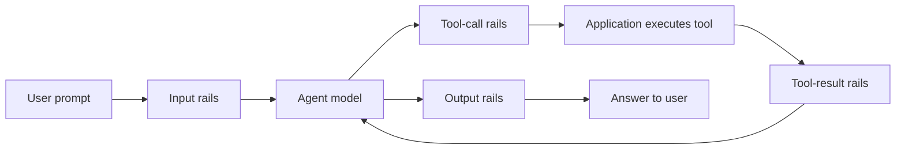

# NVIDIA NeMo Guardrails Library

Programmable guardrails for AI agents and the tools they use.

[](https://opensource.org/licenses/Apache-2.0)
[](https://pypi.org/project/nemoguardrails)
[](https://pypi.org/project/nemoguardrails)
[](https://github.com/NVIDIA-NeMo/Guardrails/actions/workflows/pr-tests.yml)
[](https://docs.nvidia.com/nemo/guardrails)

[Documentation](https://docs.nvidia.com/nemo/guardrails/latest/about-nemo-guardrails-library/overview) · [Quickstart](#quickstart-check-a-tool-call) · [Integrations](#connect-your-agent) · [Guardrail catalog](#guardrail-catalog) · [Examples](./examples)

The NVIDIA NeMo Guardrails library is an open-source Python toolkit for adding policy checks to AI agents. Validate tool names and arguments before execution, check tool results before they enter the model's context, and apply safety checks to prompts and generated answers. Define your checks in configuration files and run them in your application or as a service.

Use local rules for checks such as tool allowlists, JSON Schema validation, regex matching, and Common Expression Language (CEL) expressions. Add NVIDIA safety models, community models, third-party APIs, or custom Python actions for checks that require them.

> **LATEST RELEASE / DEVELOPMENT VERSION**: The [develop](https://github.com/NVIDIA-NeMo/Guardrails/tree/develop) branch tracks the latest top of tree development. The latest released version is [0.24.1](https://github.com/NVIDIA-NeMo/Guardrails/tree/v0.24.1).

> [!NOTE]
> This README describes the development branch. The agent quickstart below uses a source installation from `develop`; consult the documentation for your installed version when using a released package. IORails and the proxy described below are experimental.

## How it works

Your agent calls Guardrails at the boundaries you want to check. For example, a tool-using agent can apply checks at four points:



Guardrails returns a verdict; your application or agent harness enforces it. Execute a tool only after its call passes, and send a tool result to the model only after its checks pass. The library does not execute tools for you.

- **Validate tool traffic.** The IORails engine checks calls against declared tools and their argument schemas. It can also verify that a result links to an earlier call and apply additional checks per tool.
- **Keep your model and agent loop.** Use `check_async()` or the HTTP `/v1/checks` endpoint to run checks without invoking a main model. Model-backed rails still call their configured guard model or service.
- **Compose the policy you need.** Combine deterministic checks with content safety, topic control, jailbreak detection, sensitive data masking, and other rails. Checks run where you configure and invoke them.
- **Run it in your environment.** The library is Apache 2.0 licensed. Deploy it in your own application or run a guardrails service, choosing local detectors or hosted endpoints for each check.

## Installation

The library supports Python 3.10–3.13. Install a released package with:

```bash
pip install nemoguardrails
```

Optional integrations have their own extras, packages, and credentials. See the [installation guide](https://docs.nvidia.com/nemo/guardrails/latest/get-started/installation-guide) for details.

## Quickstart: check a tool call

Suppose a support agent can issue refunds, but each refund must be at most $500. This example validates the tool's arguments and applies that limit locally. It needs no model or API key.

Use Python 3.11–3.13 for the optional `cel` extra. In an activated virtual environment, install the development version:

```bash
git clone --branch develop https://github.com/NVIDIA-NeMo/Guardrails.git
cd Guardrails
pip install -e ".[cel]"
```

Create `support-agent/config.yml`:

```yaml
models: []

rails:
  tool_call:
    flows:
      - tool call validation
    per_tool:
      issue_refund:
        - cel check tool call
  config:
    cel:
      tool_call:
        issue_refund:
          expressions:
            - "args.amount > 500"
```

A CEL expression that evaluates to `true` blocks the call. Save the following as `check_refund.py` beside the `support-agent` directory:

```python
import asyncio
import json

from nemoguardrails import Guardrails, RailsConfig
from nemoguardrails.rails.llm.options import RailStatus, RailType

TOOLS = [{
    "type": "function",
    "function": {
        "name": "issue_refund",
        "parameters": {
            "type": "object",
            "properties": {"amount": {"type": "number", "minimum": 0}},
            "required": ["amount"],
            "additionalProperties": False,
        },
    },
}]


async def main():
    config = RailsConfig.from_path("./support-agent")
    async with Guardrails(config, require_iorails=True) as rails:
        for amount in (50, 5000):
            call = {
                "role": "assistant",
                "content": None,
                "tool_calls": [{
                    "id": "call_1",
                    "type": "function",
                    "function": {
                        "name": "issue_refund",
                        "arguments": json.dumps({"amount": amount}),
                    },
                }],
            }
            result = await rails.check_async(
                [call], rail_types=[RailType.TOOL_CALL], tools=TOOLS
            )
            print(f"${amount}: {result.status.value}")
            if result.status == RailStatus.PASSED:
                print("Ready for the application to execute")


asyncio.run(main())
```

Run it from the repository root:

```bash
python check_refund.py
```

Expected output:

```text
$50: passed
Ready for the application to execute
$5000: blocked
```

The script checks proposed calls without issuing a refund. In your agent loop, execute a tool only when the check passes. `require_iorails=True` makes an incompatible configuration raise an error instead of falling back to the legacy engine.

To extend the example, configure `rails.tool_result` and check returned tool messages with `RailType.TOOL_RESULT`. See [tool calling](https://docs.nvidia.com/nemo/guardrails/latest/configure-guardrails/guardrail-catalog/tool-calling), [CEL rules](./docs/configure-rails/guardrail-catalog/cel.mdx), and [checking messages](https://docs.nvidia.com/nemo/guardrails/latest/run-guardrailed-inference/using-python-apis/check-messages) for complete configuration and result handling.

## Connect your agent

Choose an interface based on where your application can run checks.

| Integration | How it connects | Coverage |
| --- | --- | --- |
| Custom agent loop or agent framework | Python `Guardrails.check_async()` | Check prompts, tool calls, tool results, and answers at the boundaries your application invokes. Tool checks require IORails and Chat Completions tool/message shapes. |
| Shared guardrails service | `nemoguardrails server` and `/v1/checks` | Run configured checks over HTTP while your application retains its model calls and tool execution. |
| Guardrailed generation | `generate_async()` or `/v1/chat/completions` | Send requests through Guardrails to a configured model. Built-in IORails tool validation supports the `openai` and `nim` engines. |
| Claude Code and Codex | `nemoguardrails hooks-server` and `/v1/hooks/claude-code` or `/v1/hooks/codex` | Check tool calls through `PreToolUse`. The hooks server does not check prompts, tool results, or final answers. |
| NeMo Relay plugin | `/v1/hooks/nemo-relay` | A plugin forwards Relay's tool conditional-execution checks to the hooks server. |
| Experimental HTTP proxy | `python -m nemoguardrails.server.experimental` | Inspect supported text requests and responses. Current built-in profiles exclude tool traffic, conversation histories, and multimodal content. |

The Guardrails API server, hooks server, and experimental proxy are separate applications with different configuration requirements. Server installations require the `server` extra. For coding-agent setup, use the [hooks examples](./examples/configs/agent_hooks) and [hooks server guide](./docs/run-rails/using-hooks-server/index.mdx). Configure the agent's failure behavior to block tool execution when a hook check cannot complete.

For other deployment paths, see [Python APIs](https://docs.nvidia.com/nemo/guardrails/latest/run-guardrailed-inference/using-python-apis), [the Guardrails API server](https://docs.nvidia.com/nemo/guardrails/latest/run-guardrailed-inference/using-fastapi-server), and [the experimental proxy](./docs/run-rails/using-proxy/index.mdx).

LangChain's `RunnableRails` integration is optional. It requires the LangChain packages used by your configuration and the opt-in `NEMOGUARDRAILS_LLM_FRAMEWORK=langchain` setting or `set_default_framework("langchain")`. See [LangChain integration](https://docs.nvidia.com/nemo/guardrails/latest/integration-with-third-party-libraries/langchain/langchain-integration).

## Guardrail catalog

| Checkpoint | Example checks |
| --- | --- |
| Input | Content safety, topic control, jailbreak and prompt-injection detection, sensitive data detection and masking |
| Tool call | Declared-tool allowlist, JSON Schema validation, per-tool regex, CEL rules, and model-backed tool safety checks |
| Tool result | Linkage to a prior call, result shape and name validation, per-tool regex, CEL rules, and model-backed tool safety checks |
| Output | Content safety, fact-checking, hallucination detection, sensitive data detection and masking |
| Retrieval | Filter or mask retrieved content before it enters a model's context |

The library also supports Colang dialog flows and custom action execution rails for applications that need them. Rail support varies by engine; consult [rail engine support](https://docs.nvidia.com/nemo/guardrails/latest/reference/rail-engine-support) when choosing or combining checks.

The [guardrail catalog](https://docs.nvidia.com/nemo/guardrails/latest/configure-guardrails/guardrail-catalog) covers NVIDIA safety models, community models, and third-party integrations, including their setup requirements. The [examples](./examples) show configurations for individual rails and integrations.

Evaluate your policy against representative allowed and blocked requests before deployment. See the [evaluation guide](https://docs.nvidia.com/nemo/guardrails/latest/evaluation) and [security guidelines](https://docs.nvidia.com/nemo/guardrails/latest/resources/guidelines) for testing and deployment guidance.

## Telemetry and privacy

The library sends anonymous usage events at startup and periodic heartbeats. Event payloads describe the library version, platform, configured engine providers, active rail categories and built-in features, and deployment mode. They exclude prompts, completions, model names, credentials, and endpoints. Per-request tracing is configured separately.

To opt out, set either environment variable before starting the library:

```bash
export NEMO_GUARDRAILS_NO_USAGE_STATS=1
# Or: export DO_NOT_TRACK=1
```

See [telemetry and privacy](https://docs.nvidia.com/nemo/guardrails/latest/resources/telemetry) for the full schema, local audit file, opt-out options, and third-party endpoint terms.

## Contributing and support

See [CONTRIBUTING.md](./CONTRIBUTING.md) for setup, issue assignment, validation, and pull request requirements, and [AI_POLICY.md](./AI_POLICY.md) for AI-assisted contributions. Ask usage questions in [GitHub Discussions](https://github.com/NVIDIA-NeMo/Guardrails/discussions).

## License and citation

The library is licensed under the [Apache License, Version 2.0](./LICENSE-Apache-2.0.txt).

If you use the NVIDIA NeMo Guardrails library in research, cite the [EMNLP 2023 paper](https://aclanthology.org/2023.emnlp-demo.40):

```bibtex
@inproceedings{rebedea-etal-2023-nemo,
    title = "{N}e{M}o Guardrails: A Toolkit for Controllable and Safe {LLM} Applications with Programmable Rails",
    author = "Rebedea, Traian  and
      Dinu, Razvan  and
      Sreedhar, Makesh Narsimhan  and
      Parisien, Christopher  and
      Cohen, Jonathan",
    editor = "Feng, Yansong  and
      Lefever, Els",
    booktitle = "Proceedings of the 2023 Conference on Empirical Methods in Natural Language Processing: System Demonstrations",
    month = dec,
    year = "2023",
    address = "Singapore",
    publisher = "Association for Computational Linguistics",
    url = "https://aclanthology.org/2023.emnlp-demo.40",
    doi = "10.18653/v1/2023.emnlp-demo.40",
    pages = "431--445",
}
```
