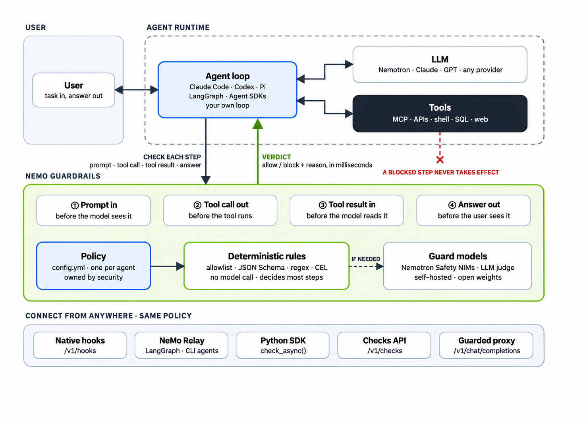
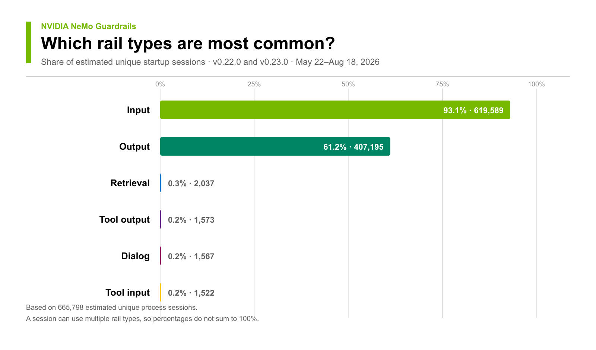
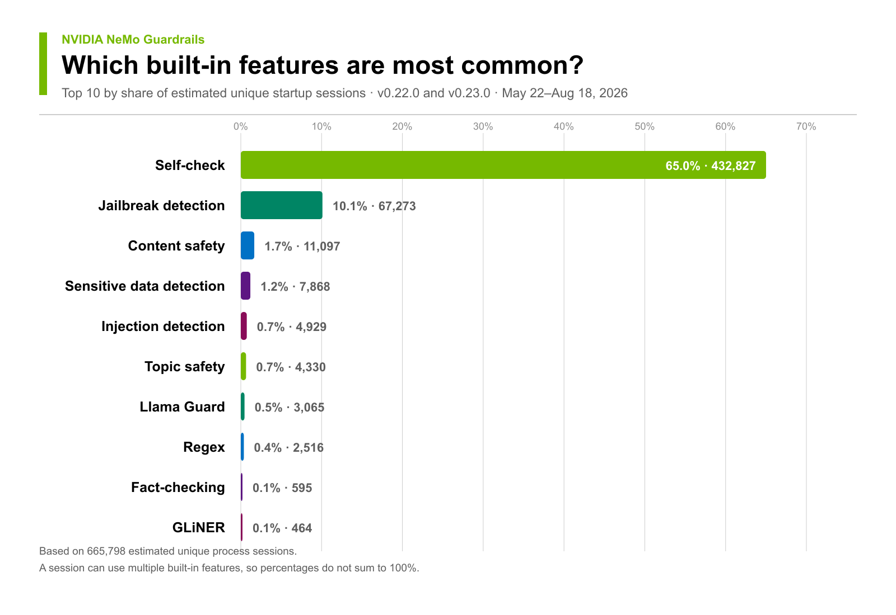
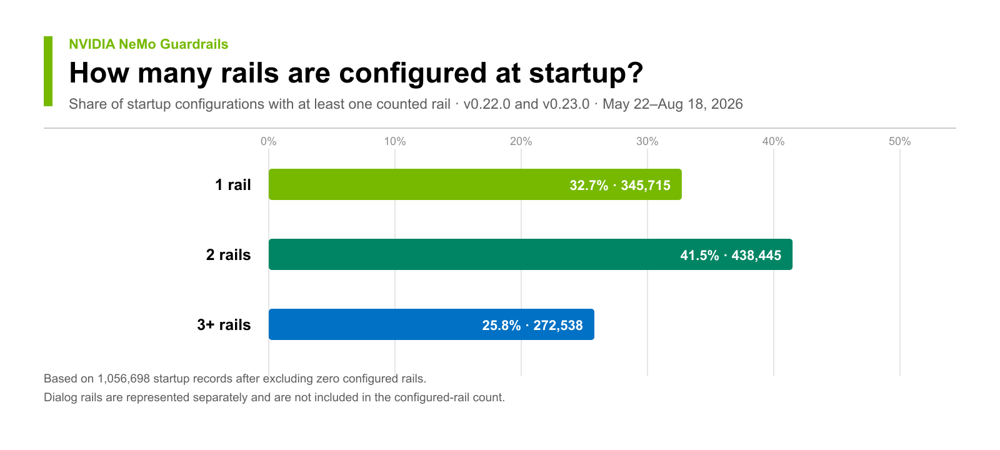

# NVIDIA NeMo Guardrails Library

Programmable safeguards for AI agents and LLM applications.

[](https://opensource.org/licenses/Apache-2.0)
[](https://pypi.org/project/nemoguardrails)
[](https://pypi.org/project/nemoguardrails)
[](https://github.com/NVIDIA-NeMo/Guardrails/actions/workflows/pr-tests.yml)
[](https://docs.nvidia.com/nemo/guardrails)

[Documentation](https://docs.nvidia.com/nemo/guardrails/latest/about-nemo-guardrails-library/overview) · [Quickstart](#quickstart) · [Use cases](#what-you-can-build) · [Integrations](#choose-your-integration) · [Guardrail catalog](#guardrail-catalog) · [Examples](./examples) · [Community](#community-usage) · [Security](./SECURITY.md) · [Releases](https://github.com/NVIDIA-NeMo/Guardrails/releases) · [Changelog](./CHANGELOG.md)

**NeMo Guardrails adds programmable safeguards to your AI agents.** For agents that run commands, call APIs, query data, or access the web, define policies to check prompts, retrieved context, tool calls, tool results, and responses. Your application or agent harness invokes the configured checks and enforces their results before continuing.

```bash
pip install nemoguardrails
```

Requires Python 3.11–3.13. Refer to the [installation guide](https://docs.nvidia.com/nemo/guardrails/latest/get-started/installation-guide) for optional packages and setup.

## What You Can Build

- **AI agents and coding assistants:** Check proposed tool calls and returned results with [tool rails](./docs/configure-rails/guardrail-catalog/tool-calling.mdx), or connect an agent through the [hooks server](./docs/run-rails/using-hooks-server/index.mdx).
- **Conversational applications:** Apply [input and output checks](./docs/run-rails/using-python-apis/check-messages.mdx) and define dialog behavior with [Colang](./docs/configure-rails/colang/index.mdx).
- **Retrieval-augmented generation (RAG):** [Detect or mask sensitive data in retrieved content](./docs/configure-rails/guardrail-catalog/pii-detection.mdx) and [check whether answers are grounded in evidence](./docs/configure-rails/guardrail-catalog/fact-checking.mdx).

## How It Works

- **Define your policy.** Configure rails, models, and prompts in YAML. Use Colang flows or Python actions for custom dialog and control logic.
- **Connect the checks.** Apply configured rails to the prompts, retrieved content, tool calls, tool results, and responses your application handles.
- **Enforce the result.** Run checks independently and act on the verdict in your application, or route generation through Guardrails. Your application controls tool execution.



Configure the checks and their order for your workflow; your application or agent harness enforces each verdict. Tool-call checks run before execution, while tool-result checks run after the tool has executed. Latency depends on the configured rules, models, and services.

Integrations support different checks. Rail support varies by engine; refer to [rail engine support](./docs/reference/rail-engine-support.mdx) and [configuration](./docs/configure-rails/configuration-reference.mdx).

## Why NeMo Guardrails

- **Govern what agents do.** Validate tool names and argument schemas before execution. Check tool results and apply per-tool policies before returning them to the model.
- **Keep your model and agent loop.** Use [checks without main-model generation](./docs/run-rails/using-python-apis/check-messages.mdx) to add guardrails to an existing application. Model-backed checks still call their configured model or service.
- **Compose the policy you need.** Combine local [regex](./docs/configure-rails/guardrail-catalog/community/regex.mdx) and [CEL](./docs/configure-rails/guardrail-catalog/cel.mdx) rules with safety models and third-party checks.
- **Connect your runtime.** Choose an [integration](#choose-your-integration) for your application, shared service, or coding agent.
- **Open and yours to run.** The library is Apache 2.0 licensed. Choose [supported model providers](./docs/about/supported-llms.mdx) and run checks with local detectors or hosted inference endpoints.

## Quickstart

Check a support agent's proposed refund against a $500 limit, without a model or API key.
Install the optional CEL extra for this example:

```bash
pip install "nemoguardrails[cel]"
```

The example validates the tool's argument schema and blocks calls over the limit. Expand it and save it as `check_refund.py`:

<details>
<summary>Complete Python example</summary>

```python
import asyncio
import json

from nemoguardrails import Guardrails, RailsConfig
from nemoguardrails.rails.llm.options import RailStatus, RailType

config = RailsConfig.from_content(yaml_content="""
models: []
rails:
  tool_call:
    flows: [tool call validation]
    per_tool:
      issue_refund: [cel check tool call]
  config:
    cel:
      tool_call:
        issue_refund:
          expressions: ["args.amount > 500"]
""")

TOOLS = [{
    "type": "function",
    "function": {
        "name": "issue_refund",
        "parameters": {
            "type": "object",
            "properties": {"amount": {"type": "number", "minimum": 0}},
            "required": ["amount"],
            "additionalProperties": False,
        },
    },
}]


async def main():
    async with Guardrails(config, require_iorails=True) as rails:
        for amount in (50, 5000):
            call = {
                "role": "assistant",
                "tool_calls": [{
                    "id": "call_1",
                    "type": "function",
                    "function": {
                        "name": "issue_refund",
                        "arguments": json.dumps({"amount": amount}),
                    },
                }],
            }
            result = await rails.check_async(
                [call], rail_types=[RailType.TOOL_CALL], tools=TOOLS
            )
            print(f"${amount}: {result.status.value}")
            if result.status == RailStatus.PASSED:
                print("Ready for the application to execute")
            else:
                print(f"Rail: {result.rail}")
                print(f"Reason: {result.reason}")


asyncio.run(main())
```

</details>

Run it from the directory where you saved the file:

```bash
python check_refund.py
```

Expected output:

```text
$50: passed
Ready for the application to execute
$5000: blocked
Rail: cel check tool call
Reason: cel check tool call
```

The example does not issue refunds. Your application executes a tool only after its checks pass.
For more configuration and error-handling examples, refer to [tool calling](./docs/configure-rails/guardrail-catalog/tool-calling.mdx) and [checking messages](./docs/run-rails/using-python-apis/check-messages.mdx).

## Choose Your Integration

Connect NeMo Guardrails where your application or agent can enforce its checks.

| What are you building? | How to connect |
| --- | --- |
| **A shared guardrails service** for multiple applications or teams | Use the [Checks API](./docs/run-rails/using-fastapi-server/overview.mdx) (`/v1/checks`) to request verdicts while each application manages its model and execution loop. |
| **An inference gateway** in front of model endpoints | Use the [experimental proxy](./docs/run-rails/using-proxy/quickstart.mdx) to check supported model requests and responses. |
| **A coding assistant or agent harness** | Use [native hooks](./docs/run-rails/using-hooks-server/run-hooks-server.mdx) or [NeMo Relay](./docs/run-rails/using-hooks-server/nemo-relay-plugin.mdx) to check tool calls before execution. |
| **An agent platform, framework integration, or custom loop** | Embed the [Python SDK](./docs/run-rails/using-python-apis/check-messages.mdx), call the [Checks API](./docs/run-rails/using-fastapi-server/overview.mdx), or use a supported [framework integration](./docs/integration/langchain/langgraph-integration.mdx). |

## Guardrail Catalog

Choose checks for your policy and workflow:

| Check | Purpose |
| --- | --- |
| [Content safety](./docs/configure-rails/guardrail-catalog/content-safety.mdx) | Check inputs and outputs against safety policies. |
| [Topic control](./docs/configure-rails/guardrail-catalog/topic-control.mdx) | Check inputs against configured topical guidelines. |
| [Jailbreak detection](./docs/configure-rails/guardrail-catalog/jailbreak-protection.mdx) | Detect jailbreak attempts with configured heuristics or classifiers. |
| [Injection detection](./docs/configure-rails/guardrail-catalog/agentic-security.mdx) | Check model output for code, SQL, template, and cross-site scripting patterns. |
| [Sensitive data and PII](./docs/configure-rails/guardrail-catalog/pii-detection.mdx) | Detect or mask sensitive data in inputs, outputs, and retrieved content. |
| [Fact-checking](./docs/configure-rails/guardrail-catalog/fact-checking.mdx) and [hallucination checks](./docs/configure-rails/guardrail-catalog/fact-checking.mdx#hallucination-detection) | Check answers against evidence or compare model responses for consistency. |
| [Tool-call and tool-result validation](./docs/configure-rails/guardrail-catalog/tool-calling.mdx) | Validate declared tools, argument schemas, and tool-result linkage and structure. |
| [Tool safety checks](./docs/configure-rails/guardrail-catalog/tool-safety-check.mdx) | Evaluate tool calls and results against per-tool safety instructions. |
| [Regex](./docs/configure-rails/guardrail-catalog/community/regex.mdx) and [CEL](./docs/configure-rails/guardrail-catalog/cel.mdx) | Apply deterministic pattern and expression rules. |
| [LLM self-checks](./docs/configure-rails/guardrail-catalog/self-check.mdx) | Use configured LLM prompts for input moderation, output moderation, or fact-checking. |
| [Language detection](./docs/configure-rails/guardrail-catalog/language-detector.mdx) | Restrict input to configured languages. |
| [Third-party integrations](./docs/configure-rails/guardrail-catalog/third-party.mdx) | Connect managed safety and moderation services. |

NVIDIA Nemotron Safety models include [Nemotron 3.5 Content Safety](./examples/configs/nemotron-3.5-content-safety), [Nemotron Content Safety Reasoning 4B](./docs/getting-started/tutorials/nemotron-content-safety-reasoning-deployment.mdx), and [Llama 3.1 Nemotron Safety Guard 8B V3](./docs/getting-started/tutorials/nemotron-safety-guard-deployment.mdx). Follow the linked examples and guides for model-specific setup.

Use the [evaluation tools](https://docs.nvidia.com/nemo/guardrails/latest/evaluation/evaluate-guardrails) to assess your policies and [garak](https://github.com/NVIDIA/garak) to scan LLM applications for vulnerabilities. Refer to the [vulnerability-scanning guide](./docs/evaluation/llm-vulnerability-scanning.mdx) for an example.

## Community Usage

This anonymous usage snapshot covers `0.22.0` and `0.23.0` release builds from May 22 to August 18, 2026, with an estimated 665,798 distinct startup sessions.

<details>
<summary>View rail usage, feature usage, and configured rail counts</summary>







Session counts are estimates, and a session can use multiple rail types or features. Refer to the [aggregate data](./docs/_static/images/community-telemetry/0.22.0-0.23.0.json) and [methodology](./docs/_static/images/community-telemetry/README.md) for definitions and counting limits.

</details>

## Telemetry and Privacy

The library sends anonymous usage telemetry that excludes prompts, completions, model names, credentials, and endpoints. Set `NEMO_GUARDRAILS_NO_USAGE_STATS=1` to opt out. This does not disable configured model or guardrail service calls, which can send content to those endpoints. Refer to [telemetry and privacy](./docs/telemetry.mdx) for details and other opt-out options.

## Contributing and Support

Refer to [CONTRIBUTING.md](./CONTRIBUTING.md) and [AI_POLICY.md](./AI_POLICY.md) for contribution requirements. Ask usage questions in [GitHub Discussions](https://github.com/NVIDIA-NeMo/Guardrails/discussions), and follow [SECURITY.md](./SECURITY.md) to report vulnerabilities.

The library is licensed under the [Apache License, Version 2.0](./LICENSE-Apache-2.0.txt). If you use it in research, cite the [EMNLP 2023 paper](https://aclanthology.org/2023.emnlp-demo.40).
