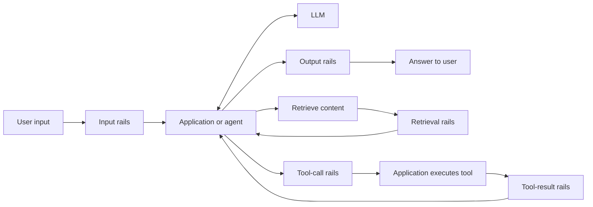

# NVIDIA NeMo Guardrails Library

Programmable safeguards for AI agents and LLM applications.

[](https://opensource.org/licenses/Apache-2.0)
[](https://pypi.org/project/nemoguardrails)
[](https://pypi.org/project/nemoguardrails)
[](https://github.com/NVIDIA-NeMo/Guardrails/actions/workflows/pr-tests.yml)
[](https://docs.nvidia.com/nemo/guardrails)

[Documentation](https://docs.nvidia.com/nemo/guardrails/latest/about-nemo-guardrails-library/overview) · [Quickstart](#quickstart) · [Use cases](#what-you-can-build) · [Guardrail catalog](#guardrail-catalog) · [Examples](./examples) · [Security](./SECURITY.md) · [Releases](https://github.com/NVIDIA-NeMo/Guardrails/releases) · [Changelog](./CHANGELOG.md)

**NeMo Guardrails adds programmable safeguards to AI agents and LLM applications.** Define policies to check inputs, retrieved context, model responses, tool calls, and tool results. Combine deterministic rules, safety models, and external services, and apply their results at configured points in your application.

```bash
pip install nemoguardrails
```

Requires Python 3.10–3.13. Refer to the [installation guide](https://docs.nvidia.com/nemo/guardrails/latest/get-started/installation-guide) for optional packages and setup.

## What You Can Build

- **AI agents and coding assistants:** Check proposed tool calls and returned results with [tool rails](./docs/configure-rails/guardrail-catalog/tool-calling.mdx), or connect an agent through the [hooks server](./docs/run-rails/using-hooks-server/index.mdx).
- **Conversational applications:** Apply [input and output checks](./docs/run-rails/using-python-apis/check-messages.mdx) and define dialog behavior with [Colang](./docs/configure-rails/colang/index.mdx).
- **Retrieval-augmented generation (RAG):** [Detect or mask sensitive data in retrieved content](./docs/configure-rails/guardrail-catalog/pii-detection.mdx) and [check whether answers are grounded in evidence](./docs/configure-rails/guardrail-catalog/fact-checking.mdx).

## How It Works

- **Define your policy.** Configure models, prompts, and rails in YAML. Add Colang flows or Python actions for custom dialog and control logic.
- **Connect the checks.** Run rails at the input, retrieval, tool, and output boundaries your application uses.
- **Apply the results.** Check messages independently and enforce verdicts in your application, or route generation through Guardrails to apply configured rails.



These are integration points you choose for your workflow. Rail support varies by engine; refer to [rail engine support](./docs/reference/rail-engine-support.mdx) and [configuration](./docs/configure-rails/configuration-reference.mdx).

## Why NeMo Guardrails

- **Govern tool use.** Validate declared tools and argument schemas, check result structure, and add per-tool policies before your application continues.
- **Compose your policy.** Combine local [regex](./docs/configure-rails/guardrail-catalog/community/regex.mdx) and [CEL](./docs/configure-rails/guardrail-catalog/cel.mdx) rules with safety models and third-party checks.
- **Keep your model and application.** Run [checks without main-model generation](./docs/run-rails/using-python-apis/check-messages.mdx), or send generation requests through Guardrails. Model-backed checks still call their configured model or service.
- **Choose your integration.** Use the [Python SDK](./docs/run-rails/using-python-apis/overview.mdx), [API server](./docs/run-rails/using-fastapi-server/overview.mdx), [coding-agent hooks](./docs/run-rails/using-hooks-server/index.mdx), [LangChain and LangGraph](./docs/integration/langchain/index.mdx), or the [experimental proxy](./docs/run-rails/using-proxy/index.mdx).
- **Run it in your environment.** The library is Apache 2.0 licensed and supports local detectors and configured inference endpoints. Refer to [supported model providers](./docs/about/supported-llms.mdx).

## Quickstart

Check a support agent's proposed refund against a $500 limit, without a model or API key.
Using Python 3.11–3.13 in an activated virtual environment:

```bash
git clone --branch develop https://github.com/NVIDIA-NeMo/Guardrails.git
cd Guardrails
pip install -e ".[cel]"
python examples/configs/tool_call_refund/check_refund.py
```

The [example configuration](./examples/configs/tool_call_refund/config.yml) validates the tool's argument schema and adds this per-tool rule:

```yaml
rails:
  tool_call:
    per_tool:
      issue_refund:
        - cel check tool call
  config:
    cel:
      tool_call:
        issue_refund:
          expressions:
            - "args.amount > 500"
```

A matching CEL expression blocks the call. The [complete example](./examples/configs/tool_call_refund/check_refund.py) checks $50 and $5,000 calls and prints the blocking rail and reason:

```text
$50: passed
Ready for the application to execute
$5000: blocked
Rail: cel check tool call
Reason: cel check tool call
```

The example does not issue refunds. Your application executes a tool only after its checks pass.
This quickstart uses the development source and experimental IORails engine. For configuration and error handling, refer to [tool calling](./docs/configure-rails/guardrail-catalog/tool-calling.mdx) and [checking messages](./docs/run-rails/using-python-apis/check-messages.mdx).

## Guardrail Catalog

Choose checks for your policy and workflow:

| Check | Purpose |
| --- | --- |
| [Content safety](./docs/configure-rails/guardrail-catalog/content-safety.mdx) | Check inputs and outputs against safety policies. |
| [Topic control](./docs/configure-rails/guardrail-catalog/topic-control.mdx) | Check inputs against configured topical guidelines. |
| [Jailbreak detection](./docs/configure-rails/guardrail-catalog/jailbreak-protection.mdx) | Detect jailbreak attempts with configured heuristics or classifiers. |
| [Injection detection](./docs/configure-rails/guardrail-catalog/agentic-security.mdx) | Check model output for code, SQL, template, and cross-site scripting patterns. |
| [Sensitive data and PII](./docs/configure-rails/guardrail-catalog/pii-detection.mdx) | Detect or mask sensitive data in inputs, outputs, and retrieved content. |
| [Fact-checking](./docs/configure-rails/guardrail-catalog/fact-checking.mdx) and [hallucination checks](./docs/configure-rails/guardrail-catalog/fact-checking.mdx#hallucination-detection) | Check answers against evidence or compare model responses for consistency. |
| [Tool-call and tool-result validation](./docs/configure-rails/guardrail-catalog/tool-calling.mdx) | Validate declared tools, argument schemas, and tool-result linkage and structure. |
| [Tool safety checks](./docs/configure-rails/guardrail-catalog/tool-safety-check.mdx) | Evaluate tool calls and results against per-tool safety instructions. |
| [Regex](./docs/configure-rails/guardrail-catalog/community/regex.mdx) and [CEL](./docs/configure-rails/guardrail-catalog/cel.mdx) | Apply deterministic pattern and expression rules. |
| [Language detection](./docs/configure-rails/guardrail-catalog/language-detector.mdx) | Detect the language of input text. |
| [Third-party integrations](./docs/configure-rails/guardrail-catalog/third-party.mdx) | Connect managed safety and moderation services. |

NVIDIA Nemotron Safety models include [Nemotron 3.5 Content Safety](./examples/configs/nemotron-3.5-content-safety), [Nemotron Content Safety Reasoning 4B](./docs/getting-started/tutorials/nemotron-content-safety-reasoning-deployment.mdx), and [Llama 3.1 Nemotron Safety Guard 8B V3](./docs/getting-started/tutorials/nemotron-safety-guard-deployment.mdx). Follow the linked examples and guides for model-specific setup.

Use the [evaluation tools](https://docs.nvidia.com/nemo/guardrails/latest/evaluation) to assess your policies and [garak](https://github.com/NVIDIA/garak) to scan LLM applications for vulnerabilities. Refer to the [vulnerability-scanning guide](./docs/evaluation/llm-vulnerability-scanning.mdx) for an example.

## Telemetry and Privacy

The library sends anonymous usage telemetry that excludes prompts, completions, model names, credentials, and endpoints. Set `NEMO_GUARDRAILS_NO_USAGE_STATS=1` to opt out. This does not disable configured model or guardrail service calls, which can send content to those endpoints. Refer to [telemetry and privacy](./docs/telemetry.mdx) for details and other opt-out options.

## Contributing and Support

Refer to [CONTRIBUTING.md](./CONTRIBUTING.md) and [AI_POLICY.md](./AI_POLICY.md) for contribution requirements. Ask usage questions in [GitHub Discussions](https://github.com/NVIDIA-NeMo/Guardrails/discussions), and follow [SECURITY.md](./SECURITY.md) to report vulnerabilities.

The library is licensed under the [Apache License, Version 2.0](./LICENSE-Apache-2.0.txt). If you use it in research, cite the [EMNLP 2023 paper](https://aclanthology.org/2023.emnlp-demo.40).
