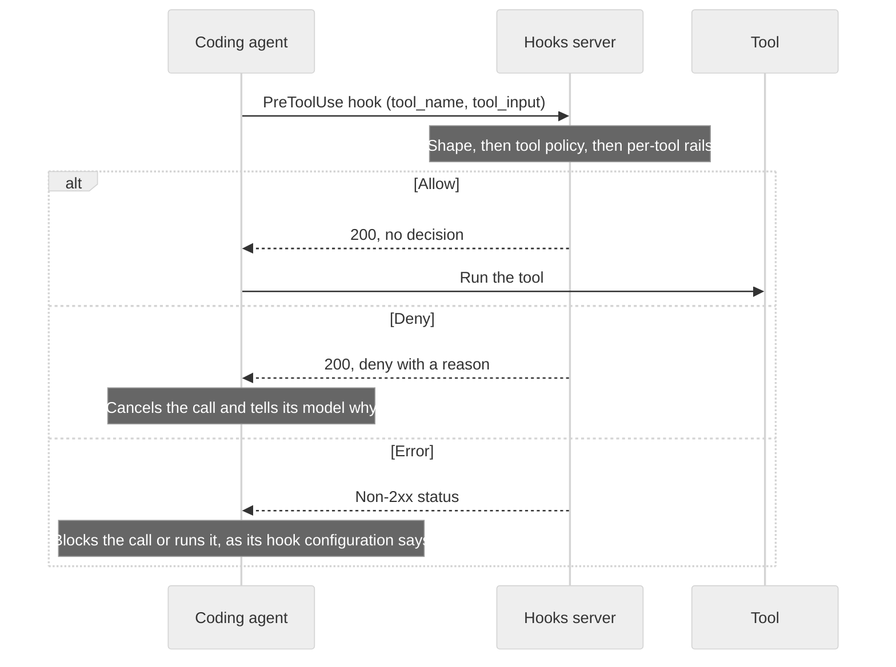

The Guardrails hooks server (`nemoguardrails hooks-server`) checks each tool call a coding agent is about to run, and answers before the agent runs it.
It provides the following capabilities:

- Receives each tool call from the agent's own pre-tool hook: an HTTP hook in Claude Code, a command hook in Codex, or a tool conditional-execution guardrail in a NeMo Relay plugin.
- Applies a tool policy that allows or blocks tools, and their arguments, by name.
- Runs per-tool rails on calls the policy allows. Options include [regular expressions](/configure-guardrails/guardrail-catalog/third-party/regex), [Common Expression Language (CEL) expressions](/configure-guardrails/guardrail-catalog/cel), and a [tool safety check](/configure-guardrails/guardrail-catalog/tool-safety-check) judged by a large language model (LLM).
- Answers in each agent's own hook output format, so the agent cancels a denied call and tells its model why.
- Needs no model, unless a rail you configure calls one.

## How a Check Works

The agent sends each tool call to the hooks server before it runs the tool.
The hooks server checks the call in three steps, and the first step that denies the call decides:

1. **The call's shape.** Arguments that are not a JSON object are denied.
1. **The tool policy.** The `hooks_server` section of the configuration names the tools a call may use and the arguments it may pass.
1. **Per-tool rails.** The rails listed for the called tool under `rails.tool_call.per_tool` check the call's arguments.
   A tool with no per-tool rails is checked by the tool policy alone.

The hooks server then returns one of three outcomes:

- **Allow:** the call passed every step. The hooks server returns no decision, so the agent's own permission rules still apply, including any prompt to the user.
- **Deny:** the tool policy or a rail blocked the call. The agent cancels the call and shows the reason, prefixed with `NeMo Guardrails:`, to its model.
- **Error:** the check could not finish, for example because a rail's model call failed. The hooks server returns a non-`2xx` status, and the agent's hook configuration decides whether the call is blocked or runs.



The hooks server applies its one configuration on every path it serves.
The path selects only the agent's request and response format, never the policy.
The policy and the rails are chosen by the tool name in each call, spelled exactly as the agent sends it, so run one hooks server for each agent.

## The Hooks Server and the Guardrails API Server

The Guardrails hooks server and the Guardrails API server run as separate processes.
The following table compares their commands, endpoints, and configuration requirements:

| Capability | Guardrails API Server | Hooks Server |
|---|---|---|
| Command | `nemoguardrails server` | `nemoguardrails hooks-server` |
| Use it for | Applications that send chat requests through guardrails, or check messages | Coding agents and NeMo Relay, checking each tool call before it runs |
| Called by | Your application | The agent's own pre-tool hook |
| Endpoints | `/v1/chat/completions`, `/v1/checks`, `/v1/models`, `/v1/rails/configs`, and a chat UI | `/v1/hooks/claude-code`, `/v1/hooks/codex`, and `/v1/hooks/nemo-relay` |
| Configurations | Several; each request selects one with `config_id` | Exactly one; callers cannot select another |
| Checks | Input, output, dialog, tool, and other rails | A tool policy and per-tool tool-call rails |
| Model | A `main` model, for chat completions | None, unless a rail calls one |
| Engine | `LLMRails`, or `IORails` with `NEMO_GUARDRAILS_IORAILS_ENGINE` set | Always `IORails` |
| Default address | `0.0.0.0:8000` | `127.0.0.1:8100` |
| Metrics address when Prometheus export is enabled | `0.0.0.0:9464` | `127.0.0.1:9465` |

Metrics export is disabled by default on both servers.
Enable it with `--metrics-exporter prometheus` or `NEMO_GUARDRAILS_SERVER_METRICS_EXPORTER=prometheus`.
Both servers answer the same health checks, `GET /v1/health` and `GET /healthz`, and return errors in the same envelope.
A configuration written for one server does not serve the other: the hooks server refuses a `main` model that no rail uses, and the Guardrails API server ignores the `hooks_server` section.
To guard an application's chat traffic and its agent's tool calls, run both servers, each with its own configuration.

<Note>

The Guardrails API server's `/v1/checks` endpoint can also check tool calls, for an application that calls its own model and passes the tools it offered.
The hooks server is for agents whose code you do not control, and that can only call out from a hook.
For `/v1/checks`, refer to [Checking Messages Against Rails](/run-guardrailed-inference/using-python-apis/check-messages#guardrails-server).

</Note>

## Supported Agents

The hooks server supports the following agent integrations:

| Agent | Path | Hook | Minimum Version |
|---|---|---|---|
| [Claude Code](/run-guardrailed-inference/using-hooks-server/claude-code) | `/v1/hooks/claude-code` | An `http` hook on `PreToolUse` | 2.1.295, for `onFailure: "block"` |
| [Codex](/run-guardrailed-inference/using-hooks-server/codex) | `/v1/hooks/codex` | A `command` hook on `PreToolUse` that runs `curl` | 0.124.0. From 0.129.0, Codex runs a hook only after you trust it |
| [NeMo Relay](/run-guardrailed-inference/using-hooks-server/nemo-relay) | `/v1/hooks/nemo-relay` | A plugin's tool conditional-execution guardrail | 0.10.1 |

The hooks server handles only the `PreToolUse` event, and the NeMo Relay guardrail that stands in for it.
Any other hook event returns HTTP `422`, so register the hooks server on `PreToolUse` only.

## Quick Start

The following steps start the hooks server with the Claude Code example configuration and send it tool calls, the way Claude Code's hook would.

### Prerequisites

Install the NVIDIA NeMo Guardrails library with the `server` extra.
For instructions, refer to [Extra Dependencies](/get-started/installation-guide#extra-dependencies).

```bash
pip install "nemoguardrails[server]"
```

The example configuration uses only regular-expression rails, so it needs no model and no API key.

### Start the Server

From a clone of the repository, start the hooks server with the [Claude Code example configuration](https://github.com/NVIDIA-NeMo/Guardrails/tree/develop/examples/configs/agent_hooks/claude_code):

```bash
nemoguardrails hooks-server --config examples/configs/agent_hooks/claude_code
```

The server listens on `http://127.0.0.1:8100`.

### Send Tool Calls

1. Send a `Bash` call that the configuration allows:

    ```bash
    curl -s http://localhost:8100/v1/hooks/claude-code \
      -H "Content-Type: application/json" \
      -d '{"hook_event_name": "PreToolUse", "tool_name": "Bash", "tool_input": {"command": "npm test"}, "tool_use_id": "toolu_01"}'
    ```

    The call is allowed, so the response carries no decision:

    ```json
    {}
    ```

1. Send a force push, which a per-tool rail in the configuration blocks:

    ```bash
    curl -s http://localhost:8100/v1/hooks/claude-code \
      -H "Content-Type: application/json" \
      -d '{"hook_event_name": "PreToolUse", "tool_name": "Bash", "tool_input": {"command": "git push --force origin main"}, "tool_use_id": "toolu_02"}'
    ```

    The call is denied, with the name of the rail that blocked it:

    ```json
    {
      "hookSpecificOutput": {
        "hookEventName": "PreToolUse",
        "permissionDecision": "deny",
        "permissionDecisionReason": "NeMo Guardrails: regex check tool call"
      }
    }
    ```

1. Send a call to `TodoWrite`, a tool that the configuration's tool policy does not list:

    ```bash
    curl -s http://localhost:8100/v1/hooks/claude-code \
      -H "Content-Type: application/json" \
      -d '{"hook_event_name": "PreToolUse", "tool_name": "TodoWrite", "tool_input": {"todos": []}, "tool_use_id": "toolu_03"}'
    ```

    The tool policy denies the call before any rail runs:

    ```json
    {
      "hookSpecificOutput": {
        "hookEventName": "PreToolUse",
        "permissionDecision": "deny",
        "permissionDecisionReason": "NeMo Guardrails: tool call 'TodoWrite' is not an allowed tool"
      }
    }
    ```

1. To check your agent's calls for real, connect it to the hooks server: [Claude Code](/run-guardrailed-inference/using-hooks-server/claude-code), [Codex](/run-guardrailed-inference/using-hooks-server/codex), or [NeMo Relay](/run-guardrailed-inference/using-hooks-server/nemo-relay).

## Known Limits

The hooks server checks the calls that reach it.
Plan your deployment around what it cannot enforce:

- **Hook settings can be edited.**
  Anyone who can edit the agent's hook settings can remove the hook, point it elsewhere, or make it let calls run when a check fails.
  To prevent that, deploy the hook through the agent's managed settings, as described on the [Claude Code](/run-guardrailed-inference/using-hooks-server/claude-code#deploy-the-hook-with-managed-settings) and [Codex](/run-guardrailed-inference/using-hooks-server/codex#deploy-the-hook-with-managed-settings) pages.
- **Some tool uses never reach the hook.**
  In Claude Code, files referenced with `@` in a prompt are read without a tool call.
  In Codex, hosted tools such as web search run on the model provider's side.
  The hooks server never sees those calls.
- **The server has no authentication.**
  Anyone who can reach it can send it calls, and so learn what the policy allows.
  It listens on `127.0.0.1` by default, so only the same machine can reach it.
  That includes the agent itself, which can call the endpoint from its own shell tool.
  Expose it on another interface only on a private network.
- **The server sees one call at a time.**
  It checks each call on its own, with no memory of earlier calls, so it cannot block a sequence of calls that are each allowed.
- **A configuration change needs a restart.**
  The server loads its configuration when it starts, and has no reload.

Hook-based checks are one layer of defense.
Combine them with the agent's own permission settings and with sandboxing.

## Related Topics

- [Run the Hooks Server](/run-guardrailed-inference/using-hooks-server/run-hooks-server)
- [Hooks Server Results and Errors](/run-guardrailed-inference/using-hooks-server/results-and-errors)
- [Hooks Server API](/reference/hooks-server-api)
- [Tool Calling](/configure-guardrails/guardrail-catalog/tool-calling)
