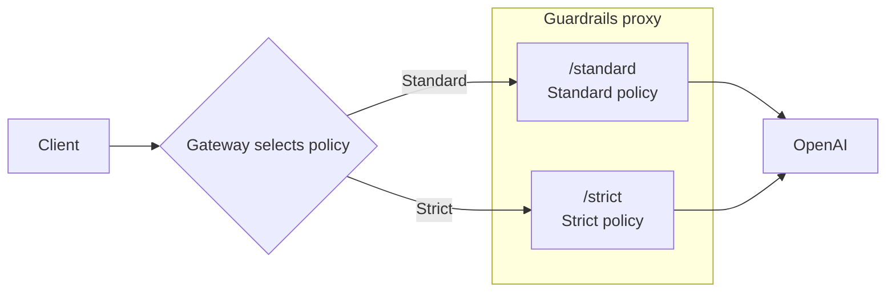

A provider instance defines how the proxy handles requests under one local path:
where to send them, which provider binding to use, and which Rails configuration
to apply. Configure multiple instances when different paths need different
upstreams or policies. The instances can use the same provider and run in one
application.

The example below exposes OpenAI at `/standard` and `/strict`, with different
Rails policies for each path. For one upstream and one policy, use the
[single-instance configuration](/run-guardrailed-inference/using-proxy/configuration#declare-a-deployment).

## Mount Multiple Provider Instances

Copy the [quickstart example](/run-guardrailed-inference/using-proxy/quickstart)
and save this as `proxy-multiple.yaml` beside its `rails` directory. Both
instances use OpenAI's native bindings and the same client credentials and model
as the quickstart. Unique mounts select different Rails configurations:

```yaml
version: 1
rails_configs:
  - id: standard
    config_path: ./rails
  - id: strict
    config_path: ./strict-rails
providers:
  - provider: openai
    instance_id: standard
    mount_path: /standard
    base_url: https://api.openai.com/v1
    operations: [chat_completions, responses]
    rails_config_id: standard
  - provider: openai
    instance_id: strict
    mount_path: /strict
    base_url: https://api.openai.com/v1
    operations: [chat_completions, responses]
    rails_config_id: strict
```

### Configure Different Rails Policies

From the deployment directory, create the second Rails configuration:

```bash
cp -R rails strict-rails
```

In `strict-rails/config.yml`, append `- '(?i)\brestricted\b'` to
`rails.config.regex_detection.input.patterns`. Preserve the existing email
pattern, input and output flows, and streaming settings. The strict policy now
blocks the word `restricted` as well as email addresses. The standard policy
keeps the quickstart checks.

### Start and Compare the Mounts

From that deployment directory, with the library environment active:

```bash
python -m nemoguardrails.server.experimental validate proxy-multiple.yaml
python -m nemoguardrails.server.experimental inspect proxy-multiple.yaml
python -m nemoguardrails.server.experimental serve proxy-multiple.yaml
```

Requests to `/standard/v1/chat/completions` use the standard policy; requests to
`/strict/v1/chat/completions` use the strict policy. Both forward allowed requests
to OpenAI. Each instance can independently select its upstream, dialect, and
Rails entry. Guarded routes retain ownership over the
provider catch-all forwarding routes.

`instance_id` identifies the instance internally. It does not automatically
become a caller header or model-routing key. Separate IDs alone do not let
several instances occupy the same local mount.

All instances in one application share its lifespan-owned HTTP client and
transport. They are not independently running replicas, and separate instances
do not provide process-level resource or failure isolation.

A root-mounted instance also reserves alternate operation paths such as
`/{api_version}/chat/completions`. Mounts such as `/v1`, `/v2`, or `/litellm` can
collide with that ownership and are rejected at construction. Use disjoint
namespaces such as `/providers/direct` and `/providers/gateway` when combining
with a root instance. The two non-root mounts above do not require a root instance.

Send the [quickstart Chat request](/run-guardrailed-inference/using-proxy/quickstart#send-a-buffered-request)
to each mounted path. Use the same `OPENAI_API_KEY` and `gpt-6-luna` model.
With input `restricted`, the strict mount returns `content_blocked` before
dispatch; the standard mount passes input inspection and calls OpenAI. With
`Hello!`, both can return accepted responses. Repeat in buffered and streaming
modes. Generated answers vary and remain subject to output checks. An
email-address input blocks before dispatch through either mount.

## Keep One Public Route

Clients can keep using `/v1/chat/completions` while an inbound gateway chooses
the Rails policy and forwards each request to the corresponding proxy mount:



Each request follows one branch. The gateway rewrites the path to
`/standard/v1/chat/completions` or `/strict/v1/chat/completions`; both proxy
instances forward allowed requests to OpenAI. Your gateway supplies the
selection rule, such as a policy based on the authenticated caller.

Alternatively, each destination can have a separate proxy deployment exposing
`/v1/chat/completions`. The gateway chooses the deployment, then optionally
balances across its equivalent replicas.

A basic connection balancer does not infer model selection from JSON. If routing
requires a model field or authenticated tenant, use infrastructure that supports
that selection or implement a trusted [outbound transport](/run-guardrailed-inference/using-proxy/advanced/http-transport).
Destination selection and balancing equivalent replicas are separate decisions.

A custom transport can choose among trusted destinations after input inspection.
The instance still has one initial, possibly logical URL. The chosen upstream
must match the already selected binding and dialect; routing does not change
inspection coverage automatically.

## Separate Identity, Policy, and Capacity

The following settings control identity, routing, and policy:

| Setting | Scope |
| --- | --- |
| `provider` | Protocol family, currently `openai` for built-in declarations. |
| `instance_id` | Unique instance identity supplied to the Rails resolver. |
| `mount_path` and application `path_prefix` | Local route ownership. |
| `base_url` | Initial outbound destination for this instance. |
| `operations` and `dialect` | Guard bindings installed for this instance. |
| `rails_config_id` or trusted resolver | One selection from the shared preloaded catalog. |
| Request `model` | Provider-owned payload value, unless your application explicitly translates it. |

Two instances can use the same provider and upstream with different mounts,
dialects, or fixed Rails selections. Register shared Rails entries once; instances
using the same ID reuse that checker. Different IDs own independent engines,
even when they refer to the same path. Dynamic selection can use the trusted
instance and operation context; refer to [Rails resolution](/run-guardrailed-inference/using-proxy/advanced/configuration-resolution).

One request selects one checker. Multiple instances or catalog entries do not
create a sequential or parallel pipeline of Rails configurations. The factory
does not provide per-instance pools, quotas, automatic failover, or model balancing.
Per-request stream adapters and hooks maintain independent protocol state, while
all instances share their application's HTTP client and checker owners.

## Prefix Routes and Avoid Collisions

Set application `path_prefix: /guarded` to place the example's operations under
`/guarded/standard/v1/...` and `/guarded/strict/v1/...`. This local prefix does not
become part of the upstream base URL. IDs and mounts must be unique; construction
validates guarded, reserved, local, and mapped-upstream ownership before serving.

Alternate aliases that reach a guarded operation are rejected without weaker
passthrough fallback. Declared canonical passthrough routes can remain available.
Operation selection is not an allowlist: enforce exposed-route restrictions in
your ingress or application, particularly when it supplies provider credentials.

## Plan Concurrency and Isolation

The shared pool can be exhausted by streams from one instance and delay others.
Tune [aggregate pool capacity](/run-guardrailed-inference/using-proxy/advanced/http-transport#connection-pool-capacity)
against expected concurrent streams and upstream capacity. Separate applications,
workers, and replicas own independent pools and Rails resources, with corresponding
startup and memory costs. They do not share or resume an established stream.

Use the [deployment guide](/run-guardrailed-inference/using-proxy/deployment) for
replicas, sidecars, embedding, access controls, and readiness. Validate concurrent
traffic through each mount and check the selected upstream and policy, including
one slow stream beside buffered traffic on another instance. Measure your own
capacity; the proxy does not establish a universal throughput guarantee.
