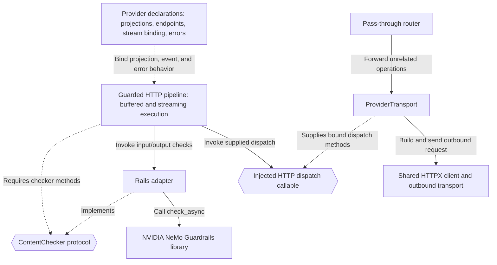
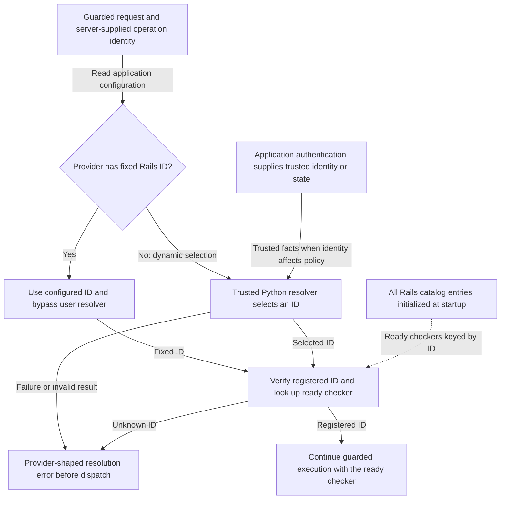

This page is for framework authors and application integrators who extend the
proxy. Read the [architecture overview](/run-guardrailed-inference/using-proxy/architecture) for system context and
the [request lifecycle](/run-guardrailed-inference/using-proxy/architecture/request-lifecycle) for execution behavior.

## Application Assembly

The YAML launcher parses a manifest into `ProxyConfig`. Python can supply that
configuration or explicit `ProviderIntegration` declarations. Both paths call
`create_proxy_application` and use the same route assembly and lifespan owners.

Construction validates declarations and routes. Lifespan startup creates network
resources and preloads the Rails catalog. Requests then use those ready owners.
Keeping these phases separate prevents request-time configuration loading and
ensures initialization failures prevent readiness.

The following artifacts define application behavior and review coverage:

| Artifact | Authority and Use |
| --- | --- |
| Manifest or Python application configuration | Select provider instances, upstreams, operations, dialects, limits, and Rails entries. Python also supplies callbacks and explicit integrations. |
| Typed projections, bindings, and endpoints | Define field coverage, selected content, capability profiles, stream events, and provider operation semantics. |
| Rails configurations | Define enabled checks, their dependencies, and streaming settings. All registered entries load at startup. |
| Exported guard contracts | Derived from typed declarations for review. The runtime does not load these exports as policy. |

Guard-contract derivation runs from typed declarations to exported YAML. Editing
an export does not change execution. Stateful hooks, arbitrary Python validation,
and transport behavior require review beyond the export. Refer to
[guard contracts](/run-guardrailed-inference/using-proxy/guard-contracts) for the exact boundary.

## Execution Dependencies

This dependency view is scoped to one proxy process. Rectangles are components
or declarations; hexagons are internal callable or protocol interfaces. Solid arrows
show invocation; dotted arrows describe declaration, protocol, and implementation
dependencies. Interfaces describe dependencies, not extra runtime services.

The execution kernels receive a checker and dispatch callable instead of
importing a provider implementation or constructing the Rails engine. Route
assembly supplies those dependencies. Provider declarations carry the API
semantics; reusable kernels control check outcomes and byte release. This lets
tests exercise execution with deterministic checkers and dispatch functions.

`ProviderTransport` adapts outbound HTTP requests and applies forwarding and
representation rules. The HTTPX transport performs the final exchange. A custom
HTTP transport does not select a new provider binding or Rails policy after
inspection.

## Composition Hooks and Internal Interfaces

Distinguish documented application composition from
the private interfaces used to implement it:

| Boundary | Intended Use |
| --- | --- |
| `create_proxy_application`, `ProxyConfig`, `ProviderConfig`, `ConfigEntry` | Assemble an application through `nemoguardrails.server.experimental.application`. |
| Explicit `ProviderIntegration` declarations | Compose reviewed endpoints through Python using the factory's direct mode. |
| `config_resolver` | Select one registered Rails ID from trusted context. It does not return a path or load configuration. |
| `http_transport_factory` | Supply a new application-wide HTTPX transport for each lifespan. The runtime closes the returned transport; a custom transport owns any child transports it creates. |
| Private `ContentChecker` and dispatch interfaces | Maintainer boundaries used by execution and its tests. The application factory does not expose a custom-checker plugin argument. |

Use the [Python integration guide](/run-guardrailed-inference/using-proxy/python-integration) for supported
composition examples and the [transport reference](/run-guardrailed-inference/using-proxy/advanced/http-transport)
for streaming and cleanup requirements.

## Trusted Rails Selection

This view shows per-request selection for declarative `ProxyConfig` providers
against a catalog that is already ready. Rectangles represent selection steps or
inputs; the diamond branches on application configuration. Solid arrows describe
selection. The
dotted arrow supplies the preloaded checker catalog. Authentication is
application-owned; receiving a request header does not make that value an
authorized policy choice.

YAML requires fixed per-provider IDs. `ProxyConfig` providers without fixed IDs
require a resolver, including with a one-entry catalog. Direct Python composition
can infer static selection from one entry when no resolver is supplied; an
explicit resolver still runs in direct mode. These assembly rules differ, while
request-time lookup uses the same preloaded repository.

The resolver receives the original buffered request and canonical operation
identity. Its cooperative deadline defaults to five seconds, independently of
provider HTTP deadlines. Async callbacks and sync callbacks returning awaitables
are supported; a blocking synchronous callback cannot be preempted by this
deadline. Cancellation must propagate without selecting a fallback configuration.

The callback owns authorization for its selection. Use trusted identity or
deliberately populated application state rather than raw caller headers. The
catalog contains trusted Rails directories and is fixed for a lifespan. Model
routing remains independent of Rails selection. Refer to
[configuration resolution](/run-guardrailed-inference/using-proxy/advanced/configuration-resolution)
for examples and failure behavior.

## State and Resource Ownership

The following scopes own declarations and runtime resources:

| Scope | Owner and Invariant |
| --- | --- |
| Bound declarations | Reusable projection models, endpoint declarations, and event-classification definitions describe coverage. |
| Application lifespan | The runtime owns one shared HTTP client, its transport, and the Rails repository. Different Rails IDs own independent engines, even for the same directory. |
| Per request | A stream binding creates a fresh adapter and protocol hooks; the kernel keeps snapshot history and pending windows per execution. Ordering, snapshots, terminal state, and error framing must not leak between requests. |
| Upstream response | Dispatch owns acquired response resources until handoff; the returned response owner handles completion, disconnect, and failure before body iteration. |

Classifiers describe events; hooks enforce stateful protocol behavior. Factories
must return independent hook instances for each request. The
[stream binding](https://github.com/NVIDIA-NeMo/Guardrails/blob/develop/nemoguardrails/server/experimental/provider/stream.py) encodes that boundary,
and the [provider composition tests](https://github.com/NVIDIA-NeMo/Guardrails/blob/develop/tests/server/experimental/test_provider_composition.py)
check request-local state. Refer to [streaming errors and cleanup](/run-guardrailed-inference/using-proxy/architecture/request-lifecycle#streaming-errors-and-cleanup)
for response ownership and cooperative cleanup limits.

## Where to Make a Change

Use these implementation and test entry points for each change:

| Change | Start Here | Verify With |
| --- | --- | --- |
| Provider operation or reviewed dialect | [Chat declarations](https://github.com/NVIDIA-NeMo/Guardrails/blob/develop/nemoguardrails/server/experimental/providers/openai/chat_completions/README.md), [Responses declarations](https://github.com/NVIDIA-NeMo/Guardrails/blob/develop/nemoguardrails/server/experimental/providers/openai/responses/README.md), and [integration assembly](https://github.com/NVIDIA-NeMo/Guardrails/blob/develop/nemoguardrails/server/experimental/providers/openai/integration.py). | [Buffered integration tests](https://github.com/NVIDIA-NeMo/Guardrails/blob/develop/tests/server/experimental/test_openai_chat_integration.py), [composition tests](https://github.com/NVIDIA-NeMo/Guardrails/blob/develop/tests/server/experimental/test_provider_composition.py), and [contract exports](https://github.com/NVIDIA-NeMo/Guardrails/blob/develop/tests/server/experimental/test_contract_export.py). |
| Event selection and streaming protocol behavior | [Event classifier declarations](https://github.com/NVIDIA-NeMo/Guardrails/blob/develop/nemoguardrails/server/experimental/providers/openai/chat_completions/stream_classifier.py) and [request-local hooks](https://github.com/NVIDIA-NeMo/Guardrails/blob/develop/nemoguardrails/server/experimental/providers/openai/chat_completions/stream_hooks.py). | [Stream classifier tests](https://github.com/NVIDIA-NeMo/Guardrails/blob/develop/tests/server/experimental/test_stream_classifier.py) and [Chat streaming tests](https://github.com/NVIDIA-NeMo/Guardrails/blob/develop/tests/server/experimental/test_openai_chat_streaming_integration.py). |
| New content capability | Matching projection, [buffered execution](https://github.com/NVIDIA-NeMo/Guardrails/blob/develop/nemoguardrails/server/experimental/_buffered_kernel.py), [streaming execution](https://github.com/NVIDIA-NeMo/Guardrails/blob/develop/nemoguardrails/server/experimental/_guarded_stream.py), and [checker semantics](https://github.com/NVIDIA-NeMo/Guardrails/blob/develop/nemoguardrails/server/experimental/_content_checker.py). | Accepted/rejected payloads, both execution modes, byte preservation, and representable exports. Profile metadata alone cannot extend support. |
| Egress, TLS, or trusted destination routing | [HTTP transport composition](/run-guardrailed-inference/using-proxy/advanced/http-transport) and the [routing example](https://github.com/NVIDIA-NeMo/Guardrails/blob/develop/nemoguardrails/server/experimental/examples/model_routing_transport.py). | [Application transport tests](https://github.com/NVIDIA-NeMo/Guardrails/blob/develop/tests/server/experimental/test_application_http_transport.py) and [routing transport tests](https://github.com/NVIDIA-NeMo/Guardrails/blob/develop/tests/server/experimental/test_model_routing_transport.py). |

Keep changes aligned with the [current content profiles](/run-guardrailed-inference/using-proxy/providers-and-streaming#coverage-of-the-shipped-profiles).
Follow [Development](https://github.com/NVIDIA-NeMo/Guardrails/blob/develop/CONTRIBUTING.md) for validation commands and release
compatibility requirements.
