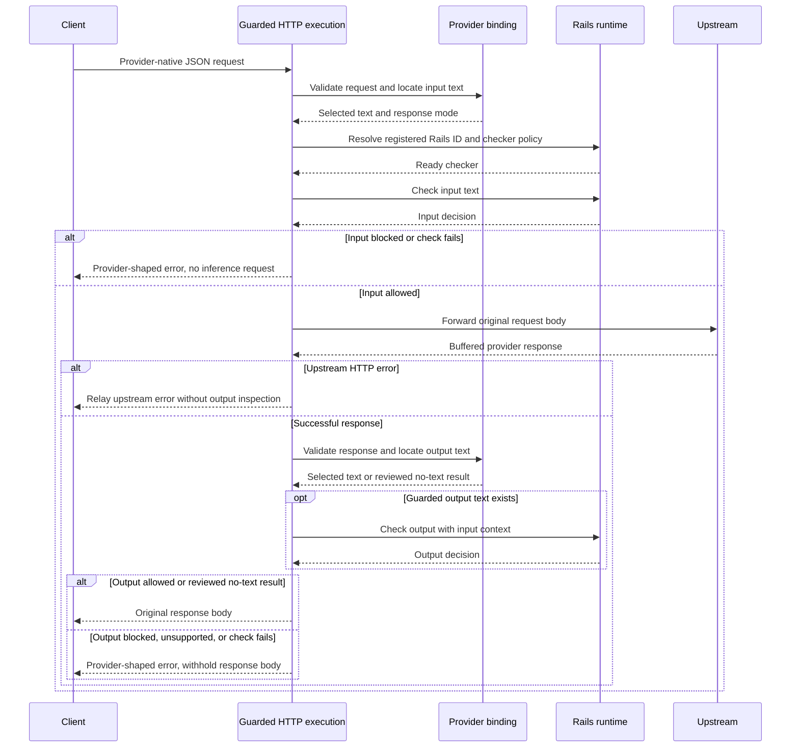
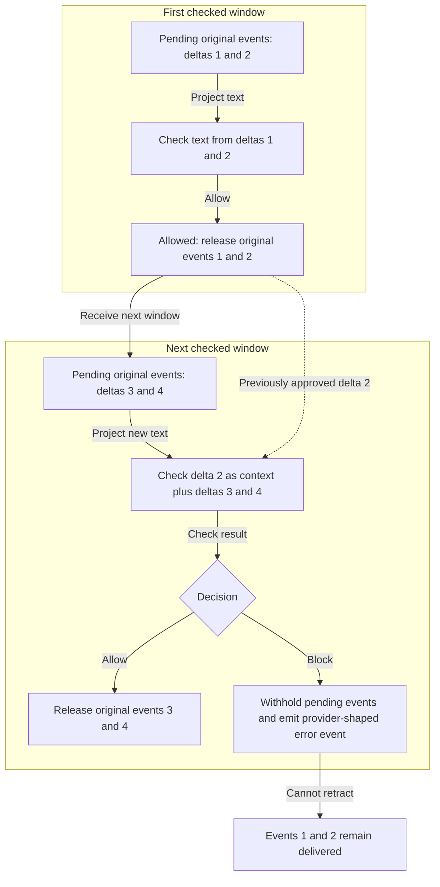
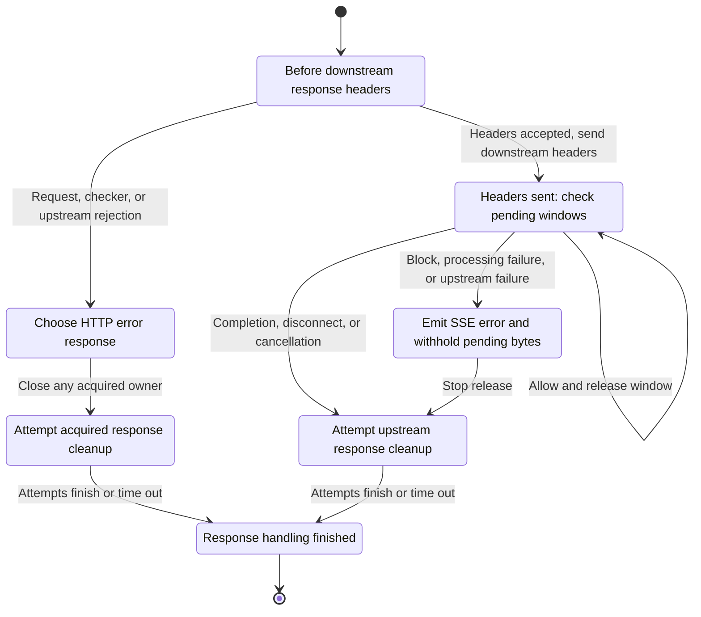

Start with the [architecture overview](/run-guardrailed-inference/using-proxy/architecture) for system boundaries
and inspection coverage. This page follows guarded operations through execution.
The buffered example enables input and output checks; the streaming examples
enable output inspection with buffering before release.

## Buffered Requests

The sequence is scoped to one buffered provider operation. The binding validates
provider shapes and locates selected text. The runtime selects a preloaded
checker and validates its policy. Request and response bodies retain their
original bytes on accepted paths. Client and Upstream are external participants;
the other lifelines are responsibilities inside the proxy process. Solid arrows
are calls or requests; dashed arrows are returns. The `alt` frames show mutually
exclusive paths, and `opt` marks conditional output checking.

Invalid requests, resolver failures, and unsupported checker configurations also
stop before dispatch. Successful inspected responses must satisfy their bound
shape even when they contain no text. Current integrations reject replacement
outcomes rather than rewriting provider content.

Input checks run only when configured; guarded request validation still applies
when input checks are disabled. With output inspection disabled, the response
bypasses output projections. HTTP limits and forwarding rules still apply to
the selected path; refer to [configuration](/run-guardrailed-inference/using-proxy/configuration#set-limits).

For an executable example of byte preservation and input and output checking, see
the [Chat integration tests](https://github.com/NVIDIA-NeMo/Guardrails/blob/develop/tests/server/experimental/test_openai_chat_integration.py).

## Caller-Visible Outcomes

For the shipped OpenAI bindings, the following outcomes describe the proxy's
error mapping. HTTP statuses below apply before downstream response headers
are committed.

<Warning>

Some execution failures handled internally by Rails currently reach the proxy as
`BLOCKED` results and are reported as `content_blocked`. A 400 response alone
does not establish that a policy detected a violation. Inspect checking-service
and application diagnostics before classifying an outage as a policy block.
Structured failure propagation is tracked in
[#2485](https://github.com/NVIDIA-NeMo/Guardrails/pull/2485); its proposed behavior
is not part of the current adapter.

</Warning>

| Outcome | Caller Sees | Inference and Content Release |
| --- | --- | --- |
| Input check blocks | HTTP 400, `content_blocked` | No inference call. |
| Buffered output check blocks | HTTP 400, `content_blocked` | Inference ran; its answer is withheld. |
| Check exception reaches the adapter, or checker returns an explicit failure | HTTP 502, `guardrails_input_check_failed` or `guardrails_output_check_failed` | Input failure prevents dispatch; output failure withholds the answer. Internally handled Rails failures can instead produce `content_blocked`, as noted above. |
| Checker requests replacement | HTTP 422, `request_content_not_replaceable`, or HTTP 502, `response_content_not_replaceable` | Input replacement prevents dispatch; output replacement withholds the answer. |
| Upstream returns an HTTP error | Upstream error response under forwarding rules | No output inspection; this is an upstream outcome. |
| Inspected stream fails after headers | Provider-shaped SSE error, if the connection is writable | Pending content is withheld; released content remains delivered. HTTP status cannot change. |

The [error mapping](https://github.com/NVIDIA-NeMo/Guardrails/blob/develop/nemoguardrails/server/experimental/providers/openai/errors.py) defines
additional validation, routing, and limit failures. The
[Chat integration tests](https://github.com/NVIDIA-NeMo/Guardrails/blob/develop/tests/server/experimental/test_openai_chat_integration.py)
assert blocked and replacement outcomes. Provider-shaped errors describe a wire
format; applications must still handle these proxy-specific codes. In particular,
an HTTP success status alone does not establish that a stream completed.

## Streaming Inspection

Streaming uses the same prepared input and input check. With output inspection
enabled, the proxy parses server-sent event (SSE) boundaries, classifies provider
events, and retains their original bytes while checking selected text windows.
The streaming kernel validates text snapshots against observed deltas.
Request-local hooks enforce provider ordering, completion, and error framing.

The example uses `chunk_size: 2` and `context_size: 1`. Each numbered delta is a
nonempty provider text delta. Sizes count deltas, not tokens, bytes, or all SSE
events. Rectangles represent pending data or processing steps; the diamond
is a check decision. Solid arrows show processing and release; the dotted arrow carries retained
text context into the next check.

Context participates in a later check without being sent twice. Pending metadata
and snapshots preserve their order relative to guarded text. Validated data-less
keepalives can be released promptly when no payload is pending. The final partial
window is checked at completion, so short responses can remain buffered until
the end.

Output inspection requires streaming checks to be enabled and
`stream_first: false`. Provider hooks enforce declared terminal behavior: Chat
uses its reviewed completion handling and `[DONE]`; Responses requires a native
terminal event. A truncated event fails without releasing its unfinished bytes.
Refer to [providers and streaming](/run-guardrailed-inference/using-proxy/providers-and-streaming) for binding-specific
coverage and settings, and the [streaming tests](https://github.com/NVIDIA-NeMo/Guardrails/blob/develop/tests/server/experimental/test_guarded_stream.py)
for release ordering and withheld content.

## Streaming Errors and Cleanup

This state view is scoped to an output-inspected stream. Arrows are lifecycle
transitions, not data dependencies. Rounded boxes are states, and the filled
circles mark entry and exit. The two cleanup states represent the same ownership
obligation on different response paths. The response-header transition determines
whether a subsequent failure can change the HTTP status.

Before returning a pre-header HTTP error, the proxy attempts cleanup of any
acquired upstream owner. Accepting upstream response headers does not validate
SSE events: event parsing and protocol checks run during body iteration, after
downstream headers are sent. A malformed first event therefore produces a
streaming error after header commitment. Processing failures in the state view
include check failures, protocol drift, and event-size or pending-byte limit violations.
Normal completion requires valid terminal behavior and approval of any final
partial window.

An error event can reach the client only while the downstream connection remains
writable. Already released content remains delivered after a failure. A reviewed
upstream HTTP error is relayed before streaming begins, and reviewed provider
error events follow the binding's provider-aware handling.

The application response owner closes the upstream source independently of
the body iterator, including failure before iteration starts. Iterated guarded
streams also attempt cleanup in their finalization path. Cleanup is cooperative,
bounded, shielded, and must tolerate repeat attempts; finishing response handling
does not prove that an uncooperative owner released every resource.

Event-size and pending-byte limits reject oversized inspected streams. They are
not a complete process memory budget and do not impose universal bounds on
unrelated pass-through traffic. Read/idle timeouts and cleanup budgets are
separate controls.

Follow [streaming HTTP ownership](https://github.com/NVIDIA-NeMo/Guardrails/blob/develop/nemoguardrails/server/experimental/_streaming_http.py),
the [streaming kernel](https://github.com/NVIDIA-NeMo/Guardrails/blob/develop/nemoguardrails/server/experimental/_guarded_stream.py), and their
[HTTP tests](https://github.com/NVIDIA-NeMo/Guardrails/blob/develop/tests/server/experimental/test_streaming_http.py) and
[kernel tests](https://github.com/NVIDIA-NeMo/Guardrails/blob/develop/tests/server/experimental/test_guarded_stream.py). For application-wide
owners, refer to [framework state ownership](/run-guardrailed-inference/using-proxy/architecture/framework-internals#state-and-resource-ownership).
