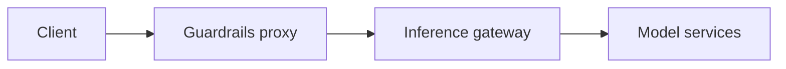

Choose where requests enter the proxy, where inference runs, and which checks
apply as separate decisions. The proxy can serve a fixed upstream, compose
several provider instances, or sit alongside infrastructure that owns routing.

## Choose a Topology

Choose a topology based on your routing and resource requirements:

| Need | Topology |
| --- | --- |
| Add checks to one model endpoint | One proxy instance with one configured upstream. |
| Scale equivalent proxy capacity | A load balancer in front of equivalent replicas. |
| Address several upstreams through one process | Unique provider mounts in one application. |
| Keep one public path for several destinations | A gateway choosing internal mounts/deployments, or a custom outbound transport. |
| Reuse an inference gateway's routing | Set that gateway as the provider's fixed `base_url`. |
| Separate teams, credentials, regions, or rollout schedules | Independent proxy deployments, each optionally replicated. |
| Integrate with an existing service | Python application composition with explicit lifespan ownership. |

These are deployment patterns, not built-in retry, service-discovery, quota,
or authentication services. Supply the required policy in your application or
infrastructure.

## Start With One Upstream

The client sends a request to the proxy's `/v1/chat/completions` route. The proxy
applies its configured checks and forwards allowed requests to the upstream's
`/v1/chat/completions` route.

The [quickstart](/run-guardrailed-inference/using-proxy/quickstart) uses this topology. A provider instance has one
initial `base_url`, a set of operation bindings, and a selected Rails config.
You do not need a custom transport just to change that URL.

## Configure Multiple Destinations

Use [multiple provider instances and routing](/run-guardrailed-inference/using-proxy/advanced/multiple-provider-instances)
for a complete two-mount manifest, shared-policy choices, route prefixes, and
collision rules. That guide also covers keeping one public route through an
inbound gateway or a trusted application transport.

## Put the Proxy in Front of a Model Gateway



Configure the gateway URL and explicit dialect. Let the gateway own its model
aliases, destination credentials, balancing, and any retry policy it implements.
The proxy continues to check the content selected by its bindings on the way
in and out. This can keep one public endpoint in front of many model services
without implementing routing inside the proxy.

## Replicas, Embedding, and Sidecars

Equivalent replicas can share public paths and configuration while keeping
independent client pools and preloaded Rails resources. An established stream
stays with its handling replica; the proxy does not migrate or resume it on
another replica.

Use a local companion or sidecar when each workload owns its proxy configuration.
That multiplies client pools and initialized Rails resources across deployments.
The proxy does not automatically intercept network traffic.

For an embedded FastAPI application, connect startup and shutdown to the actual
parent lifespan. Mounting an ASGI application alone does not establish that its
lifespan ran. Refer to [Python integration](/run-guardrailed-inference/using-proxy/python-integration#lifespan-and-embedding).

## Credentials and Access

The launcher binds loopback by default and does not authenticate inbound callers.
Use your application's access controls or an inbound gateway before exposing it to untrusted callers.
Authorize access to provider mounts and Rails selections using trusted identity.

The default transport forwards caller upstream credentials under its header
rules. If an application changes origins, it must select credentials belonging
to the destination and remove caller credentials that should not cross origins.
Never obtain arbitrary destination URLs or Rails paths from untrusted callers.

Upstream cookies are not persisted in the shared client. Explicit caller Cookie
and upstream Set-Cookie headers can still pass through. Shared connection pools
are not shared caller sessions.

Operation selection is not a route allowlist. Restrict unselected routes,
including stored-response retrieval, and direct access to the upstream according
to your enforcement requirements. Disabling output checks leaves response bytes
uninspected even when the operation is selected.

## Health and Readiness

Your application or deployment owns liveness, readiness, and access controls.
The launcher does not install `/health`, `/ready`, or a metrics
endpoint. Register [local routers](/run-guardrailed-inference/using-proxy/python-integration#local-application-routes)
before provider catch-alls, or expose probes on the embedding parent.

Readiness must wait for successful lifespan startup of every catalog entry.
A successful `validate`, TCP connection, or static liveness handler is not that
signal. Withdraw readiness before draining and coordinate the probe with your
ingress and process manager. A mounted child does not run its lifespan by itself.

## Connection Pools

Provider instances share the application's outbound connection pool; separate
workers and replicas own independent pools and Rails resources. Active streams
can contend with other traffic. Refer to [pool capacity and tuning](/run-guardrailed-inference/using-proxy/advanced/http-transport#connection-pool-capacity)
before sizing a deployment for concurrent users and instances.

## Streaming and Resource Ownership

Start the launcher with an explicit request-drain budget when needed:

```bash
python -m nemoguardrails.server.experimental serve proxy.yaml --timeout-graceful-shutdown 30
```

The default is 30 seconds. On shutdown the server drains active requests until
that deadline, cancels remaining requests, then runs application cleanup. Give
the deployment's termination grace room for both draining and resource cleanup.
Separate cooperative cleanup attempts have their own budgets; neither they nor
the outbound HTTP timeout establish a total request deadline or force-close
blocking custom code.

Configure any fronting gateway's buffering, timeouts, and disconnect handling
for the delivery behavior you need. Its buffering can delay SSE even when the
proxy releases events incrementally.

Budget startup time and resources for every declared Rails config in each
replica. A failed configuration prevents that replica from serving.

Treat cleanup timeout logs as incomplete cleanup and investigate the affected
owner. Refer to [cleanup semantics](/run-guardrailed-inference/using-proxy/advanced/http-transport#constraints-and-ownership)
for cancellation and resource ownership requirements.

Windowed checks cannot retract released content. Retrying or failing over after
partial output needs explicit application semantics; the transport hook does
not provide exactly-once inference or resumable SSE.

For symptom-based diagnosis and cleanup log messages, refer to
[operator troubleshooting](/run-guardrailed-inference/using-proxy/troubleshooting).
